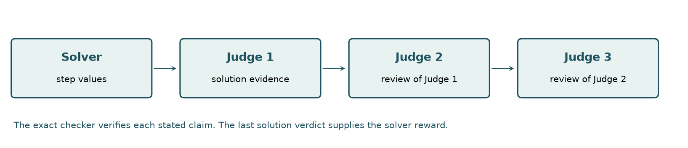
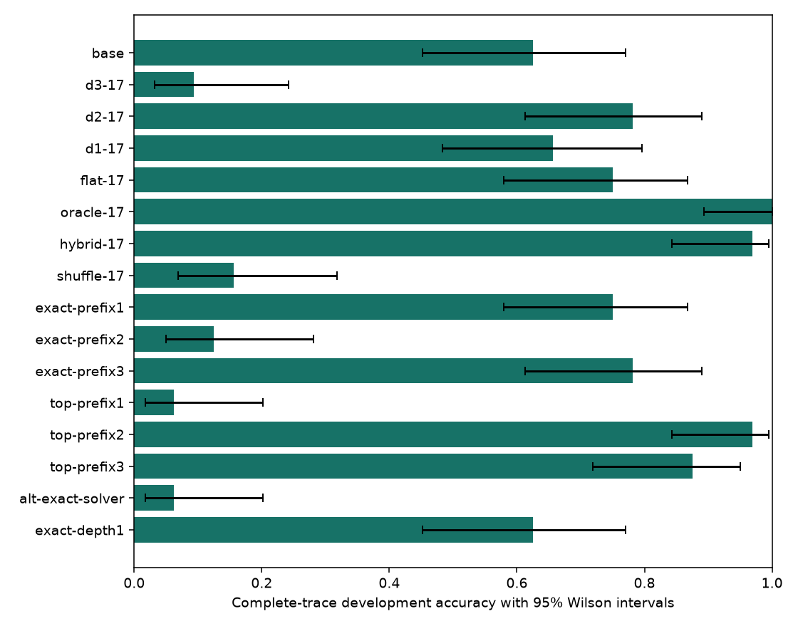

# Does a third LLM judge improve GRPO rewards?

A small language model solves numbered arithmetic problems. A second call judges the solution, a third checks that judgment, and a fourth checks the review. An exact integer evaluator can check each answer and each piece of evidence. We measure whether the final reviewer catches errors and whether its reward improves a solver trained with Group Relative Policy Optimization. [Preregistration](reports/preregistration.md)

For example, a solver can give the right final answer to (4 + 3) × 2 while recording 8 in the first step. A reviewer can endorse the correct rejection and still give the wrong correction. The study distinguishes both mistakes.

<!-- RESULTS:START -->






Amended primary comparison is pending. Every arm uses two-add problems and demonstrated prompts.

| Run | Updated role | Updates | Development exact | Development n | Held-out exact | Held-out n |
|---|---|---:|---:|---:|---:|---:|
| base | solver | — | 62.5% | 32 | — | 0 |
| d3-17 | solver | 256 | 9.4% | 32 | — | 0 |
| d2-17 | solver | 256 | 78.1% | 32 | — | 0 |
| d1-17 | solver | 256 | 65.6% | 32 | — | 0 |
| flat-17 | solver | 256 | 75.0% | 32 | — | 0 |
| oracle-17 | solver | 256 | 100.0% | 32 | — | 0 |
| hybrid-17 | solver | 256 | 96.9% | 32 | — | 0 |
| shuffle-17 | solver | 256 | 15.6% | 32 | — | 0 |
| exact-j1 | j1 | 256 | 62.5% | 32 | — | 0 |
| exact-j2 | j2 | 256 | 46.9% | 32 | — | 0 |
| exact-j3 | j3 | 256 | 31.2% | 32 | — | 0 |
| top-j2 | j2 | 256 | 43.8% | 32 | — | 0 |
| top-j1 | j1 | 256 | 50.0% | 32 | — | 0 |
| exact-prefix1 | solver | 256 | — | 0 | — | 0 |
| learn-oracle-17 | solver | 128 | — | 0 | — | 0 |
| learn-shuffle-17 | solver | 128 | — | 0 | — | 0 |

**Benchmark difficulty.** The frozen-model screen selected two-add with demonstrated prompts. On 16 screening problems it produced a mix of correct and incorrect answers on 2 problems. [All difficulty levels](reports/learnability.md).

**Solver learning.** Exact-reward training changed complete-trace accuracy on 256 fresh problems by +36.3 percentage points relative to the starting solver (paired 95% interval +30.1 to +42.6). [Shuffled control and arithmetic corrections](reports/learnability.md).

On the original signed development population, base solved 0/32, d3-17 solved 0/32.

**Untrained solver.** Every step was correct on 20 of 32 development problems. Of 0 malformed outputs, 0 contained all correct numbers as named assignments. Judge 3 corrected 0 of Judge 2’s verdicts and introduced 2 errors on these traces.

**First three-judge-trained solver.** Every step was correct on 3 of 32 development problems. Of 1 malformed outputs, 0 contained all correct numbers as named assignments. Judge 3 corrected 1 of Judge 2’s verdicts and introduced 1 errors on these traces.

[Interactive results explorer](https://burnycoder.github.io/verifying-verifier-of-verifier-llm-reinforcement-learning/) · [Paper](reports/paper.pdf)
<!-- RESULTS:END -->

### Experiment

The learnability screen measures answer formatting, exact arithmetic and within-problem reward variation on progressively harder tasks. A matched exact-reward and shuffled-reward pilot tests improvement on fresh problems before scaling the study. [Learnability protocol](reports/learnability-preregistration.md)

The first run trains only the solver against three frozen judges. Subsequent runs compare depth, flat voting, programmatic rewards, a hybrid gate and shuffled rewards. We then train the judges one at a time with exact supervision or supervision from the next judge. The final stage trains solvers against partial and complete sets of trained judges and refreshes all four roles in alternating blocks. The primary metric is complete-trace accuracy on the same held-out problems. [Run matrix](reports/planned-runs.md) · [Analysis protocol](reports/preregistration.md)

Prior work established third-order pairwise critique and proof meta-verification. We test an online reward with an executable truth label for each review field. Results apply to this shared-backbone arithmetic system. [Wen et al.](https://arxiv.org/html/2502.04675v4) · [DeepSeekMath-V2](https://arxiv.org/html/2511.22570v1) · [Literature review](reports/literature-review.md) · [State-of-the-art review](reports/state-of-the-art-review.md)

### Reproduction

Use Python 3.12 and uv. The GPU profile uses a CUDA 13.2 PyTorch wheel, a pinned Qwen checkpoint, TRL, PEFT, and bitsandbytes. The CPU profile supports oracle tests, publication and analysis. Copy `.env.example` to `.env` for local storage overrides. Keep credentials in the local GitHub and Hugging Face credential stores. [Qwen model card](https://huggingface.co/Qwen/Qwen2.5-1.5B-Instruct) · [TRL](https://huggingface.co/docs/trl/grpo_trainer)

```sh
uv sync --extra gpu
uv run --extra gpu pytest
uv run --extra gpu study campaign
uv run study dashboard
uv run study report
```

The campaign measures a disposable block, locks the update budget and completes the original first solver. It then screens the task and measures an exact-reward training gain on fresh problems. A qualifying result fixes the difficulty and prompt style for all matched solver and judge comparisons. Each evaluation links to its checkpoint. The local dashboard reads development measurements as they arrive. The static explorer, figures and paper read persisted results. [Implementation guide](docs/usage.md) · [Study plan](reports/plan.md) · [Progress](reports/progress.md)

### Milestones

- [ ] Complete the frozen-judge solver comparison.
- [ ] Evaluate Judge 3 on natural reviews and paired evidence changes.
- [ ] Compare exact and top-down judge supervision and alternating training.
- [ ] Release complete paired held-out results, positive and negative examples, and the reproducible analysis.
