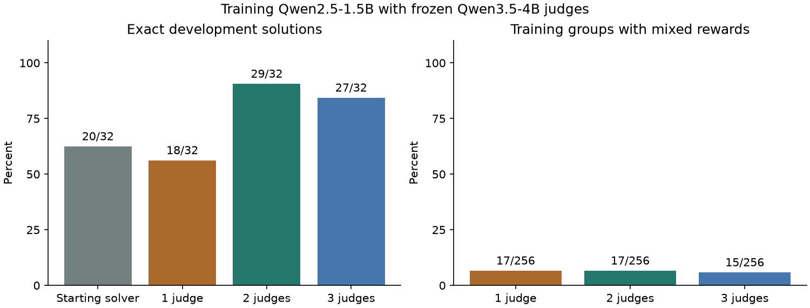
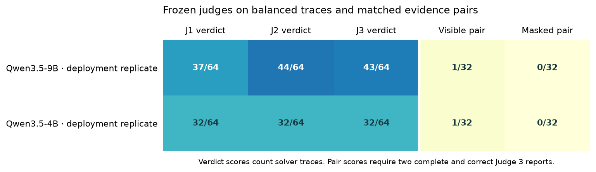
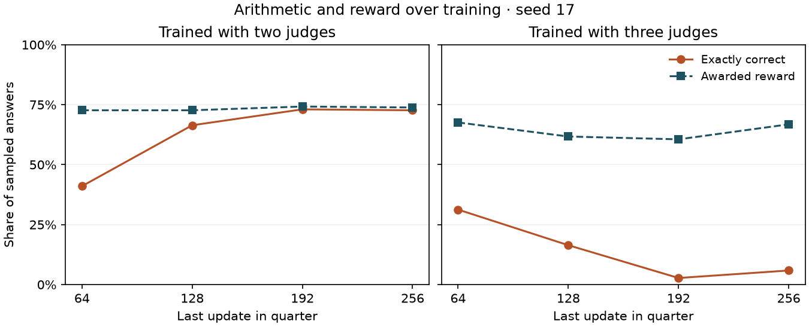
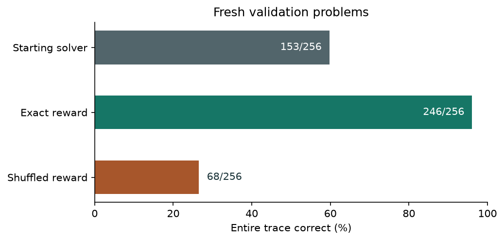
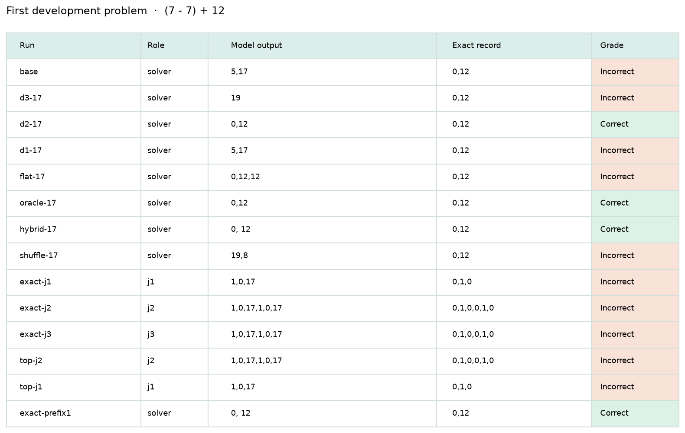

# Does a third LLM judge improve GRPO rewards?

A small language model solves numbered arithmetic problems. A second call judges the solution, a third checks that judgment, and a fourth checks the review. An exact integer evaluator can check each answer and each piece of evidence. We measure whether the final reviewer catches errors and whether its reward improves a solver trained with Group Relative Policy Optimization. [Preregistration](reports/preregistration.md)

For example, a solver can give the right final answer to (4 + 3) × 2 while recording 8 in the first step. A reviewer can endorse the correct rejection and still give the wrong correction. [Compare the two trained solvers’ answers and each judge’s actual output](#what-did-the-solvers-and-judges-actually-write).

<!-- RESULTS:START -->
## Solvers trained with frozen Qwen3.5-4B judges

| Solver reward | Updates | Groups with mixed rewards | Exact development solutions |
| --- | --- | --- | --- |
| Starting solver | 0 | — | 20/32 |
| Frozen Qwen3.5-4B Judge 2 | 256 | 17/256 | 29/32 |
| Frozen Qwen3.5-4B Judge 3 | 256 | 15/256 | 27/32 |

The three-judge solver changed exact development accuracy by -6.2 percentage points relative to the two-judge solver (paired 95% interval -15.6 to +0.0). It gained 0 solutions and lost 2 on the 32 shared problems. During three-judge training, Judge 3 fixed 4 solution verdicts and introduced 0 errors across 1,024 sampled answers. Using Judge 3 changed the within-group advantages in 0/256 groups on those same samples. The interval conditions on these seed-17 checkpoints and the development population. The first difference in sampled solver answers occurred at update 3. All earlier groups gave the two solvers the same relative credit. An earlier change in judge credit therefore cannot explain this first divergence. The logs do not identify which computation produced the differing sample. [Protocol and decoder](https://github.com/BurnyCoder/verifying-verifier-of-verifier-llm-reinforcement-learning/blob/main/reports/newer-frozen-judges.md#online-solver-comparison) · [Rollouts, rewards and exact scores](https://github.com/BurnyCoder/verifying-verifier-of-verifier-llm-reinforcement-learning/tree/main/results/new-judges).

### Grading each checkpoint's fixed answers

| Whose written answers? | Exact solver answers | Correct J2 verdicts | Correct J3 verdicts | J3 fixes | J3 new errors |
| --- | --- | --- | --- | --- | --- |
| Solver trained with Judge 2 | 29/32 | 28/32 | 28/32 | 0 | 0 |
| Solver trained with Judge 3 | 27/32 | 26/32 | 26/32 | 0 | 0 |

A correct verdict accepts correct arithmetic or rejects an arithmetic or format error. Changing a verdict in this replay leaves the solver’s written answer fixed.



### Both solvers on the same development calculation

| Expression | Exact steps | Two-judge-trained solver and reviews | Three-judge-trained solver and reviews |
| --- | --- | --- | --- |
| (12 - 12) + 11 | 0, 11 | `0,11` (correct), J2 `1,0,11,1,0,11`, J3 `1,0,11,1,0,11` | `0,13` (wrong), J2 `1,0,13,1,0,13`, J3 `1,0,13,1,0,13` |
| (39 + 12) - 5 | 51, 46 | `51,46` (correct), J2 `1,0,46,1,0,46`, J3 `1,0,46,1,0,46` | `51,46` (correct), J2 `1,0,46,1,0,46`, J3 `1,0,46,1,0,46` |
| (7 - 7) + 12 | 0, 12 | `0,19` (wrong), J2 `1,0,19,1,0,19`, J3 `1,0,19,1,0,19` | `0,19` (wrong), J2 `1,0,19,1,0,19`, J3 `1,0,19,1,0,19` |

Each solver writes its answer before grading. In the six-number reviews, the first number audits the preceding judge and the fourth accepts or rejects the solver. The examples take the first problem in each observed pair of outcomes in evaluation order.

### Solver precision and pretraining-only hardware checks

| Solver | Precision | GPU test | Parsed | Exact | Peak solver allocation |
| --- | --- | --- | --- | --- | --- |
| Qwen2.5-1.5B-Instruct | NF4 | One update completed | 16/16 | 10/16 | 1,990 MiB |
| Qwen2.5-1.5B-Instruct | BF16 | One update completed | 16/16 | 9/16 | 3,161 MiB |

Starting accuracy uses greedy decoding on the same train-split calibration problems before the disposable update. The 4B judge ran on the same GPU. Peak allocation is PyTorch memory for the solver process alone. [Hardware protocol](https://github.com/BurnyCoder/verifying-verifier-of-verifier-llm-reinforcement-learning/blob/main/reports/solver-precision.md) · [Measured costs and outcomes](https://github.com/BurnyCoder/verifying-verifier-of-verifier-llm-reinforcement-learning/tree/main/results/solver-fit).

[Paired effects and independent reward checks](https://github.com/BurnyCoder/verifying-verifier-of-verifier-llm-reinforcement-learning/blob/main/reports/reviews/online-solvers.md).

**Independent frozen-judge confirmation.** On 64 fresh problems, frozen Qwen3.5-4B correctly audited both reviews on 10/64 evidence pairs, compared with 1/64 for Qwen2.5-1.5B-Instruct. Their third judges correctly graded 73/128 and 61/128 fixed solver traces, respectively. For Qwen3.5-4B, Judge 3 agreed with Judge 2 on every solution verdict. The paired 95% intervals for the differences were +6.25 to +23.44 percentage points for evidence and +1.56 to +17.97 for verdicts. The selected judge qualified for the online solver comparison.

[Run inventory, including upcoming experiments](https://github.com/BurnyCoder/verifying-verifier-of-verifier-llm-reinforcement-learning/blob/main/reports/run-inventory.md) · [Newer frozen Qwen protocol](https://github.com/BurnyCoder/verifying-verifier-of-verifier-llm-reinforcement-learning/blob/main/reports/newer-frozen-judges.md) · [Paused solver checkpoint, update 16](https://huggingface.co/BurnyCoder/recursive-judge-grpo-adapters/tree/5274be501a83e4c881664370cfe75f912c69413f/resumable/calibrated/top-depth2/checkpoint-16)

<details>
<summary>All runs, their results, and what is still scheduled</summary>

The original solver and judge adapters all use Qwen2.5-1.5B-Instruct. A solver score counts complete arithmetic traces. A trained judge score counts complete evidence records. Stack replays report verdict agreement at each depth on the same saved answers. Pending means the phase has no completed measurement. A dash marks an inapplicable endpoint. Timing and calibration are outside the primary comparison.

### Original signed arithmetic

| Run | Treatment or measurement | Status | Development or pilot result | Held-out result |
| --- | --- | --- | --- | --- |
| [original/base](https://github.com/BurnyCoder/verifying-verifier-of-verifier-llm-reinforcement-learning/tree/main/results/base) | Untrained solver | Archived | 0/32 (0.0%) | Deferred |
| [original/d3-17](https://github.com/BurnyCoder/verifying-verifier-of-verifier-llm-reinforcement-learning/tree/main/results/d3-17) | Fresh solver, frozen J3, seed 17 | Archived | 0/32 (0.0%) | Deferred |
| [original/timing](https://github.com/BurnyCoder/verifying-verifier-of-verifier-llm-reinforcement-learning/blob/main/results/timing/trained.json) | Disposable solver, frozen J3, wall-clock pilot | Complete | 4 updates in 153.2 s | — |
| original/registered-only | Other original signed treatments and sealed evaluation | Superseded in this campaign | See calibrated arms below | Deferred |

### Difficulty and learning controls

| Run | Treatment or measurement | Status | Development or pilot result | Held-out result |
| --- | --- | --- | --- | --- |
| [screen/one-registered](https://github.com/BurnyCoder/verifying-verifier-of-verifier-llm-reinforcement-learning/blob/main/results/learnability/screen.json) | Frozen solver, greedy trace | Complete | 0/16 (0.0%) | — |
| [screen/one-demonstrated](https://github.com/BurnyCoder/verifying-verifier-of-verifier-llm-reinforcement-learning/blob/main/results/learnability/screen.json) | Frozen solver, greedy trace | Complete | 15/16 (93.8%) | — |
| [screen/two-add-registered](https://github.com/BurnyCoder/verifying-verifier-of-verifier-llm-reinforcement-learning/blob/main/results/learnability/screen.json) | Frozen solver, greedy trace | Complete | 0/16 (0.0%) | — |
| [screen/two-add-demonstrated](https://github.com/BurnyCoder/verifying-verifier-of-verifier-llm-reinforcement-learning/blob/main/results/learnability/screen.json) | Frozen solver, greedy trace | Complete | 9/16 (56.2%) | — |
| [screen/two-mixed-registered](https://github.com/BurnyCoder/verifying-verifier-of-verifier-llm-reinforcement-learning/blob/main/results/learnability/screen.json) | Frozen solver, greedy trace | Complete | 0/16 (0.0%) | — |
| [screen/two-mixed-demonstrated](https://github.com/BurnyCoder/verifying-verifier-of-verifier-llm-reinforcement-learning/blob/main/results/learnability/screen.json) | Frozen solver, greedy trace | Complete | 12/16 (75.0%) | — |
| [screen/registered-registered](https://github.com/BurnyCoder/verifying-verifier-of-verifier-llm-reinforcement-learning/blob/main/results/learnability/screen.json) | Frozen solver, greedy trace | Complete | 0/16 (0.0%) | — |
| [screen/registered-demonstrated](https://github.com/BurnyCoder/verifying-verifier-of-verifier-llm-reinforcement-learning/blob/main/results/learnability/screen.json) | Frozen solver, greedy trace | Complete | 2/16 (12.5%) | — |
| [learnability/confirm](https://github.com/BurnyCoder/verifying-verifier-of-verifier-llm-reinforcement-learning/blob/main/results/learnability/confirm.json) | Fresh difficulty confirmation, greedy trace | Complete | 31/48 (64.6%) | — |
| [learnability/audit](https://github.com/BurnyCoder/verifying-verifier-of-verifier-llm-reinforcement-learning/blob/main/results/learnability/audit.json) | Frozen balanced verdicts at J1/J2/J3 and visible J3 twins | Complete | 46.9% / 40.6% / 40.6%, twins 0/16 | — |
| [validation/base](https://github.com/BurnyCoder/verifying-verifier-of-verifier-llm-reinforcement-learning/blob/main/results/learnability/evaluations/base.json) | Frozen solver, independent validation | Complete | 153/256 (59.8%) | — |
| [validation/learn-oracle-17](https://github.com/BurnyCoder/verifying-verifier-of-verifier-llm-reinforcement-learning/blob/main/results/learnability/evaluations/learn-oracle-17.json) | Solver, exact reward, independent validation | Complete | 246/256 (96.1%) | — |
| [validation/learn-shuffle-17](https://github.com/BurnyCoder/verifying-verifier-of-verifier-llm-reinforcement-learning/blob/main/results/learnability/evaluations/learn-shuffle-17.json) | Solver, shuffled exact reward, independent validation | Complete | 68/256 (26.6%) | — |

### Main solver and judge study

| Run | Treatment or measurement | Status | Development or pilot result | Held-out result |
| --- | --- | --- | --- | --- |
| [calibrated/base](https://github.com/BurnyCoder/verifying-verifier-of-verifier-llm-reinforcement-learning/tree/main/results/calibrated/base) | Frozen starting solver | Development complete | 20/32 (62.5%) | Deferred |
| [calibrated/d3-17](https://github.com/BurnyCoder/verifying-verifier-of-verifier-llm-reinforcement-learning/tree/main/results/calibrated/d3-17) | Fresh solver, D3, seed 17 | Development complete | 3/32 (9.4%) | Deferred |
| [calibrated/d2-17](https://github.com/BurnyCoder/verifying-verifier-of-verifier-llm-reinforcement-learning/tree/main/results/calibrated/d2-17) | Fresh solver, D2, seed 17 | Development complete | 25/32 (78.1%) | Deferred |
| [calibrated/d1-17](https://github.com/BurnyCoder/verifying-verifier-of-verifier-llm-reinforcement-learning/tree/main/results/calibrated/d1-17) | Fresh solver, D1, seed 17 | Development complete | 21/32 (65.6%) | Deferred |
| [calibrated/flat-17](https://github.com/BurnyCoder/verifying-verifier-of-verifier-llm-reinforcement-learning/tree/main/results/calibrated/flat-17) | Fresh solver, three independent votes, seed 17 | Development complete | 24/32 (75.0%) | Deferred |
| [calibrated/oracle-17](https://github.com/BurnyCoder/verifying-verifier-of-verifier-llm-reinforcement-learning/tree/main/results/calibrated/oracle-17) | Fresh solver, exact trace, seed 17 | Development complete | 32/32 (100.0%) | Deferred |
| [calibrated/hybrid-17](https://github.com/BurnyCoder/verifying-verifier-of-verifier-llm-reinforcement-learning/tree/main/results/calibrated/hybrid-17) | Fresh solver, J3 and checker, seed 17 | Development complete | 31/32 (96.9%) | Deferred |
| [calibrated/shuffle-17](https://github.com/BurnyCoder/verifying-verifier-of-verifier-llm-reinforcement-learning/tree/main/results/calibrated/shuffle-17) | Fresh solver, within-group shuffled J3, seed 17 | Development complete | 5/32 (15.6%) | Deferred |
| [calibrated/exact-j1](https://github.com/BurnyCoder/verifying-verifier-of-verifier-llm-reinforcement-learning/tree/main/results/calibrated/exact-j1) | J1 learns from exact full report | Development complete | 20/32 (62.5%) | Deferred |
| [calibrated/exact-j2](https://github.com/BurnyCoder/verifying-verifier-of-verifier-llm-reinforcement-learning/tree/main/results/calibrated/exact-j2) | J2 learns from exact full report | Development complete | 15/32 (46.9%) | Deferred |
| [calibrated/exact-j3](https://github.com/BurnyCoder/verifying-verifier-of-verifier-llm-reinforcement-learning/tree/main/results/calibrated/exact-j3) | J3 learns from exact full report | Development complete | 10/32 (31.2%) | Deferred |
| [calibrated/top-j2](https://github.com/BurnyCoder/verifying-verifier-of-verifier-llm-reinforcement-learning/tree/main/results/calibrated/top-j2) | J2 learns from exact-j3 | Development complete | 14/32 (43.8%) | Deferred |
| [calibrated/top-j1](https://github.com/BurnyCoder/verifying-verifier-of-verifier-llm-reinforcement-learning/tree/main/results/calibrated/top-j1) | J1 learns from top-j2 | Development complete | 16/32 (50.0%) | Deferred |
| [calibrated/exact-prefix1](https://github.com/BurnyCoder/verifying-verifier-of-verifier-llm-reinforcement-learning/tree/main/results/calibrated/exact-prefix1) | Fresh solver, D3, 1 exact-trained judge, seed 17 | Development complete | 24/32 (75.0%) | Deferred |
| [calibrated/exact-prefix2](https://github.com/BurnyCoder/verifying-verifier-of-verifier-llm-reinforcement-learning/tree/main/results/calibrated/exact-prefix2) | Fresh solver, D3, 2 exact-trained judges, seed 17 | Development complete | 4/32 (12.5%) | Deferred |
| [calibrated/exact-prefix3](https://github.com/BurnyCoder/verifying-verifier-of-verifier-llm-reinforcement-learning/tree/main/results/calibrated/exact-prefix3) | Fresh solver, D3, 3 exact-trained judges, seed 17 | Development complete | 25/32 (78.1%) | Deferred |
| [calibrated/top-prefix1](https://github.com/BurnyCoder/verifying-verifier-of-verifier-llm-reinforcement-learning/tree/main/results/calibrated/top-prefix1) | Fresh solver, D3, 1 top-down judge, seed 17 | Development complete | 2/32 (6.2%) | Deferred |
| [calibrated/top-prefix2](https://github.com/BurnyCoder/verifying-verifier-of-verifier-llm-reinforcement-learning/tree/main/results/calibrated/top-prefix2) | Fresh solver, D3, 2 top-down judges, seed 17 | Development complete | 31/32 (96.9%) | Deferred |
| [calibrated/top-prefix3](https://github.com/BurnyCoder/verifying-verifier-of-verifier-llm-reinforcement-learning/tree/main/results/calibrated/top-prefix3) | Fresh solver, D3, 3 top-down judges, seed 17 | Development complete | 28/32 (87.5%) | Deferred |
| [calibrated/alt-exact-j1](https://github.com/BurnyCoder/verifying-verifier-of-verifier-llm-reinforcement-learning/tree/main/results/calibrated/alt-exact-j1) | J1 learns from exact full report, continuing exact-j1 | Development complete | 20/32 (62.5%) | Deferred |
| [calibrated/alt-exact-j2](https://github.com/BurnyCoder/verifying-verifier-of-verifier-llm-reinforcement-learning/tree/main/results/calibrated/alt-exact-j2) | J2 learns from exact full report, continuing exact-j2 | Development complete | 15/32 (46.9%) | Deferred |
| [calibrated/alt-exact-j3](https://github.com/BurnyCoder/verifying-verifier-of-verifier-llm-reinforcement-learning/tree/main/results/calibrated/alt-exact-j3) | J3 learns from exact full report, continuing exact-j3 | Development complete | 10/32 (31.2%) | Deferred |
| [calibrated/alt-exact-solver](https://github.com/BurnyCoder/verifying-verifier-of-verifier-llm-reinforcement-learning/tree/main/results/calibrated/alt-exact-solver) | Continue solver, D3, 3 exact-trained judges, seed 17 | Development complete | 2/32 (6.2%) | Deferred |
| [calibrated/alt-top-j3](https://github.com/BurnyCoder/verifying-verifier-of-verifier-llm-reinforcement-learning/tree/main/results/calibrated/alt-top-j3) | J3 learns from exact full report, continuing exact-j3 | Development complete | 10/32 (31.2%) | Deferred |
| calibrated/alt-top-j2 | J2 learns from alt-top-j3, continuing top-j2 | Deferred | Pending | Deferred |
| calibrated/alt-top-j1 | J1 learns from alt-top-j2, continuing top-j1 | Deferred | Pending | Deferred |
| calibrated/alt-top-solver | Continue solver, D3, 3 top-down judges, seed 17 | Deferred | Pending | Deferred |
| calibrated/d3-29 | Fresh solver, D3, seed 29 | Deferred | Pending | Deferred |
| calibrated/d2-29 | Fresh solver, D2, seed 29 | Deferred | Pending | Deferred |
| calibrated/flat-29 | Fresh solver, three independent votes, seed 29 | Deferred | Pending | Deferred |
| calibrated/d3-43 | Fresh solver, D3, seed 43 | Deferred | Pending | Deferred |
| calibrated/d2-43 | Fresh solver, D2, seed 43 | Deferred | Pending | Deferred |
| calibrated/flat-43 | Fresh solver, three independent votes, seed 43 | Deferred | Pending | Deferred |

### Matched trained judge depths

| Run | Treatment or measurement | Status | Development or pilot result | Held-out result |
| --- | --- | --- | --- | --- |
| [calibrated/exact-depth1](https://github.com/BurnyCoder/verifying-verifier-of-verifier-llm-reinforcement-learning/tree/main/results/calibrated/exact-depth1) | Fresh solver, D1, 1 exact-trained judge, seed 17 | Development complete | 20/32 (62.5%) | Deferred |
| [calibrated/exact-depth2](https://github.com/BurnyCoder/verifying-verifier-of-verifier-llm-reinforcement-learning/tree/main/results/calibrated/exact-depth2) | Fresh solver, D2, 2 exact-trained judges, seed 17 | Development complete | 20/32 (62.5%) | Deferred |
| [calibrated/top-depth1](https://github.com/BurnyCoder/verifying-verifier-of-verifier-llm-reinforcement-learning/tree/main/results/calibrated/top-depth1) | Fresh solver, D1, 1 top-down judge, seed 17 | Development complete | 25/32 (78.1%) | Deferred |
| [calibrated/top-depth2](https://github.com/BurnyCoder/verifying-verifier-of-verifier-llm-reinforcement-learning/tree/main/results/calibrated/top-depth2) | Fresh solver, D2, 2 top-down judges, seed 17 | Paused · 20/256 logged, checkpoint 16 | Pending | Deferred |
| [replay/exact](https://github.com/BurnyCoder/verifying-verifier-of-verifier-llm-reinforcement-learning/tree/main/results/calibrated/matched-depth) | Frozen fitted stack, J1/J2/J3 on identical base traces | Development complete | 20/32 · 20/32 · 20/32 | Deferred |
| [replay/top](https://github.com/BurnyCoder/verifying-verifier-of-verifier-llm-reinforcement-learning/tree/main/results/calibrated/matched-depth) | Frozen fitted stack, J1/J2/J3 on identical base traces | Development complete | 20/32 · 18/32 · 18/32 | Deferred |

### Final evaluation and transfer

| Run | Treatment or measurement | Status | Development or pilot result | Held-out result |
| --- | --- | --- | --- | --- |
| analysis/primary | D3 minus D2, paired across seeds 17, 29 and 43 | Deferred | — | Pending |
| analysis/flat | D3 minus three independent votes, same seeds | Deferred | — | Pending |
| cohort/test | Primary arithmetic, 2,048 questions per solver | Deferred | — | Pending |
| cohort/layout | Reserved tree layouts, 128 questions per solver | Deferred | — | Pending |
| cohort/long | Longer expressions, 128 questions per solver | Deferred | — | Pending |
| cohort/original-difficulty | Signed arithmetic, 2,048 questions per solver | Deferred | — | Pending |
| cohort/mechanism | Familiar evidence and layout, 128 evidence pairs, visible and masked | Deferred | — | Pending |
| cohort/unseen-evidence | Unseen error pattern, 128 evidence pairs, visible and masked | Deferred | — | Pending |
| cohort/layout-evidence | Reserved layout, 128 evidence pairs, visible and masked | Deferred | — | Pending |
| cohort/transfer-evidence | Unseen error and reserved layout, 128 evidence pairs, visible and masked | Deferred | — | Pending |

### Newer frozen Qwen judges

| Run | Treatment or measurement | Status | Development or pilot result | Held-out result |
| --- | --- | --- | --- | --- |
| [new-judges/runtime-format-pilot](https://github.com/BurnyCoder/verifying-verifier-of-verifier-llm-reinforcement-learning/tree/main/results/new-judges/runtime-format-pilot) | Qwen3.5-9B server-output formatting diagnostic | Archived, invalid scoring | Empty reasoning wrapper on 65/65 delivered messages. No accuracy estimate. | — |
| [new-judges/q35-9b-ollama](https://github.com/BurnyCoder/verifying-verifier-of-verifier-llm-reinforcement-learning/tree/main/results/new-judges/q35-9b-ollama) | Qwen3.5-9B frozen, Ollama Q4_K_M deployment replicate | Complete | J3 verdict 43/64, twins 1/32, masked 0/32 | — |
| [new-judges/q35-4b-ollama](https://github.com/BurnyCoder/verifying-verifier-of-verifier-llm-reinforcement-learning/tree/main/results/new-judges/q35-4b-ollama) | Qwen3.5-4B frozen, Ollama Q4_K_M deployment replicate | Complete | J3 verdict 32/64, twins 1/32, masked 0/32 | — |
| [new-judges/q25-1p5b](https://github.com/BurnyCoder/verifying-verifier-of-verifier-llm-reinforcement-learning/tree/main/results/new-judges/q25-1p5b) | Qwen2.5-1.5B-Instruct frozen, same-runtime screen | Complete | J3 verdict 28/64, twins 0/32, masked 0/32 | — |
| [new-judges/q35-4b](https://github.com/BurnyCoder/verifying-verifier-of-verifier-llm-reinforcement-learning/tree/main/results/new-judges/q35-4b) | Qwen3.5-4B frozen, same-runtime screen | Complete | J3 verdict 35/64, twins 7/32, masked 0/32 | — |
| [new-judges/q35-9b](https://github.com/BurnyCoder/verifying-verifier-of-verifier-llm-reinforcement-learning/tree/main/results/new-judges/q35-9b) | Qwen3.5-9B frozen, same-runtime screen | Complete | J3 verdict 43/64, twins 4/32, masked 0/32 | — |
| [new-judges/q38-27b](https://github.com/BurnyCoder/verifying-verifier-of-verifier-llm-reinforcement-learning/tree/main/results/new-judges/q38-27b) | Qwen3.8-27B frozen, same-runtime screen | Incomplete, sustained latency | The 4 pilot calls averaged 2.56 seconds. Stopped after 51 scored requests. Consecutive requests exceeded the 30-second ceiling and the slowdown persisted after reloading the same file. No cohort accuracy estimate | — |
| [new-judges/q38-27b-iq1s](https://github.com/BurnyCoder/verifying-verifier-of-verifier-llm-reinforcement-learning/tree/main/results/new-judges/q38-27b-iq1s) | Frozen 27B IQ1_S, fresh screen conditional on sustained latency at higher precision | Complete | J3 verdict 36/64, twins 5/32, masked 0/32 | — |
| [new-judges/confirm-control](https://github.com/BurnyCoder/verifying-verifier-of-verifier-llm-reinforcement-learning/tree/main/results/new-judges/confirm-control) | Frozen Qwen2.5 control, fresh confirmation | Complete | J3 verdict 61/128, twins 1/64, masked 0/64 | — |
| [new-judges/confirm-winner](https://github.com/BurnyCoder/verifying-verifier-of-verifier-llm-reinforcement-learning/tree/main/results/new-judges/confirm-winner) | Selected newer frozen judge, fresh confirmation · Qwen3.5-4B | Complete | J3 verdict 73/128, twins 10/64, masked 0/64 | — |
| [new-judges/winner-d2](https://github.com/BurnyCoder/verifying-verifier-of-verifier-llm-reinforcement-learning/tree/main/results/new-judges/winner-d2) | Fresh Qwen2.5 solver, selected frozen J2 reward, seed 17 · Qwen3.5-4B | Evaluated | 29/32 (90.6%) exact solver traces | — |
| [new-judges/winner-d3](https://github.com/BurnyCoder/verifying-verifier-of-verifier-llm-reinforcement-learning/tree/main/results/new-judges/winner-d3) | Fresh Qwen2.5 solver, selected frozen J3 reward, seed 17 · Qwen3.5-4B | Evaluated | 27/32 (84.4%) exact solver traces | — |

### Solver hardware and train-split calibration

| Run | Treatment or measurement | Status | Development or pilot result | Held-out result |
| --- | --- | --- | --- | --- |
| [solver-fit/original-nf4](https://github.com/BurnyCoder/verifying-verifier-of-verifier-llm-reinforcement-learning/tree/main/results/solver-fit/original-nf4) | Qwen/Qwen2.5-1.5B-Instruct, NF4, disposable GRPO update | One update completed | 10/16 exact before the update | — |
| [solver-fit/original-bf16](https://github.com/BurnyCoder/verifying-verifier-of-verifier-llm-reinforcement-learning/tree/main/results/solver-fit/original-bf16) | Qwen/Qwen2.5-1.5B-Instruct, BF16, disposable GRPO update | One update completed | 9/16 exact before the update | — |
| solver-fit/original-int8 | Qwen/Qwen2.5-1.5B-Instruct, INT8, disposable GRPO update | BF16 fit; fallback unnecessary | Pending | — |
| solver-fit/base-2b | Qwen/Qwen3.5-2B-Base, NF4, disposable GRPO update | Scheduled | Pending | — |

</details>

## Matched accuracy by judge depth

Each column adds one review of the preceding judge. Judge 1 checks the solver, Judge 2 checks Judge 1, and Judge 3 checks Judge 2. Across a solver-training row only the depth of its reward changes. All solver comparisons here use seed 17.

### Development solver accuracy

Every solver answers the same 32 questions. A solution is correct when every intermediate value is correct. Fitted judges stay frozen during solver updates.

| Training condition | One judge · J1 | Two judges · J2 checks J1 | Three judges · J3 checks J2 |
| --- | --- | --- | --- |
| Only solver trained · original judges | 21/32 (65.6%) | 25/32 (78.1%) | 3/32 (9.4%) |
| Exact-trained judges, then solver | 20/32 (62.5%) | 20/32 (62.5%) | 25/32 (78.1%) |
| Top-down-trained judges, then solver | 25/32 (78.1%) | Pending | 28/32 (87.5%) |

With judges first trained on exact labels, the one-judge and two-judge solver runs wrote identical text on 1,024/1,024 training completions. Their applied rewards matched on 1,024/1,024, with 1,024 and 1,024 positive rewards respectively. Their solver outputs also matched on 32/32 development questions.

### Development judge verdict accuracy

Every judge grades the same 32 saved responses from the starting solver. A verdict is correct when it agrees with the arithmetic checker. In all judge-only conditions the solver itself stays at 20/32 (62.5%) on the 32 solver-evaluation questions.

| Training condition | One judge · J1 | Two judges · J2 checks J1 | Three judges · J3 checks J2 |
| --- | --- | --- | --- |
| Original frozen judges | 19/32 (59.4%) | 19/32 (59.4%) | 17/32 (53.1%) |
| Exact labels · only final judge trained | 20/32 (62.5%) | 19/32 (59.4%) | 18/32 (56.2%) |
| Exact labels · all participating judges trained | 20/32 (62.5%) | 20/32 (62.5%) | 20/32 (62.5%) |
| Top-down supervision · only final judge trained | 20/32 (62.5%) | 19/32 (59.4%) | 18/32 (56.2%) |
| Top-down supervision · all participating judges trained | 20/32 (62.5%) | 18/32 (56.2%) | 18/32 (56.2%) |

On the original frozen judges’ row, Judge 3 fixed Judge 2’s verdict on 0/32 answers and introduced a grading error on 2/32. Always accepting scores 20/32 (62.5%) on these same responses. The stack trained on exact labels approved all 32 answers at every depth, including all 12 incorrect solutions. The stack trained top-down approved 32, 30, 30 answers at depths one, two and three, respectively. It accepted all 12 incorrect solutions at every depth.

<details><summary>Every verdict Judge 3 changed on the starting solver’s saved answers</summary>

| Problem | Starting solver wrote | Correct steps | Judge 2 | Judge 3 | Effect |
| --- | --- | --- | --- | --- | --- |
| <code>(46 + 3) - 10</code> | <code>56,46</code> | <code>49,39</code> | Endorses Judge 1 and supports the value 46. Rejects the solver and says step 1 should be 46.<br><code>1,0,46,0,1,46</code> | Flags field 3 of Judge 2 and proposes 46. Accepts the solver and gives 46 as its final value.<br><code>0,3,46,1,0,46</code> | Introduced a grading error |
| <code>(1 + 6) - 6</code> | <code>-5,-1</code> | <code>7,1</code> | Invalid review flag -1. Its solver fields say “Accepts the solver and gives -5 as its final value.” The effective verdict is reject.<br><code>-1,-1,-5,1,0,-5</code> | Endorses Judge 2 and supports the value -5. Accepts the solver and gives -5 as its final value.<br><code>1,0,-5,1,0,-5</code> | Introduced a grading error |

</details>

“Only final judge trained” fits the judge used for that column’s terminal decision and uses original judges for preceding calls. “All participating judges trained” uses fitted adapters at every depth. Top-down training uses the shared exact-trained Judge 3. Pending cells have no completed matched measurement. [Matched comparison protocol](reports/matched-depth-protocol.md)

## Newer frozen judges on fixed solver answers

Every depth grades the same solver responses within a cohort. A visible-pair success requires both complete audit records and the exact numerical correction. Each balanced problem contributes one valid trace and one invalid trace. The last column counts Judge 2 errors that Judge 3 fixed, followed by correct Judge 2 verdicts that Judge 3 overturned.

| Model and cohort | J1 verdict | J2 verdict | J3 verdict | J3 visible pairs | J3 masked pairs | J3 fixes / new errors |
| --- | --- | --- | --- | --- | --- | --- |
| Qwen3.5-9B · deployment replicate · balanced | 37/64 | 44/64 | 43/64 | 1/32 | 0/32 | 0 / 1 |
| Qwen3.5-9B · deployment replicate · natural | 23/32 | 24/32 | 24/32 | — | — | 0 / 0 |
| Qwen3.5-4B · deployment replicate · balanced | 32/64 | 32/64 | 32/64 | 1/32 | 0/32 | 0 / 0 |
| Qwen3.5-4B · deployment replicate · natural | 26/32 | 26/32 | 26/32 | — | — | 0 / 0 |
| Qwen2.5-1.5B-Instruct · screen · balanced | 32/64 | 28/64 | 28/64 | 0/32 | 0/32 | 16 / 16 |
| Qwen2.5-1.5B-Instruct · screen · natural | 23/32 | 19/32 | 13/32 | — | — | 4 / 10 |
| Qwen3.5-4B · screen · balanced | 35/64 | 35/64 | 35/64 | 7/32 | 0/32 | 0 / 0 |
| Qwen3.5-4B · screen · natural | 24/32 | 24/32 | 24/32 | — | — | 0 / 0 |
| Qwen3.5-9B · screen · balanced | 36/64 | 45/64 | 43/64 | 4/32 | 0/32 | 3 / 5 |
| Qwen3.5-9B · screen · natural | 24/32 | 23/32 | 24/32 | — | — | 1 / 0 |
| Qwen3.8-27B · amended screen · balanced | 35/64 | 35/64 | 36/64 | 5/32 | 0/32 | 1 / 0 |
| Qwen3.8-27B · amended screen · natural | 20/32 | 14/32 | 13/32 | — | — | 0 / 1 |
| Qwen2.5-1.5B-Instruct · confirmation · balanced | 64/128 | 63/128 | 61/128 | 1/64 | 0/64 | 23 / 25 |
| Qwen3.5-4B · confirmation · balanced | 72/128 | 73/128 | 73/128 | 10/64 | 0/64 | 0 / 0 |

Qwen3.5-9B · Archived, invalid scoring. Empty reasoning wrapper on 65/65 delivered messages. No accuracy estimate..

Qwen3.5-9B (deployment replicate, Ollama-Qwen3.5-9B-Q4_K_M.gguf) used 191,377 input and 4,963 output tokens in 241.4 seconds of end-to-end calls.

Qwen3.5-4B (deployment replicate, Ollama-Qwen3.5-4B-Q4_K_M.gguf) used 191,363 input and 4,918 output tokens in 158.2 seconds of end-to-end calls.

Qwen2.5-1.5B-Instruct (screen, qwen2.5-1.5b-instruct-q4_k_m.gguf) used 189,653 input and 5,036 output tokens in 61.3 seconds of end-to-end calls.

Qwen3.5-4B (screen, Qwen3.5-4B-Q4_K_M.gguf) used 191,362 input and 4,918 output tokens in 162.2 seconds of end-to-end calls.

Qwen3.5-9B (screen, Qwen3.5-9B-Q4_K_M.gguf) used 191,371 input and 5,018 output tokens in 251.2 seconds of end-to-end calls.

Qwen3.8-27B · Incomplete, sustained latency. The 4 pilot calls averaged 2.56 seconds. Stopped after 51 scored requests. Consecutive requests exceeded the 30-second ceiling and the slowdown persisted after reloading the same file. No cohort accuracy estimate.

Qwen3.8-27B (amended screen, Qwen3.8-27B-UD-IQ1_S.gguf) used 197,374 input and 4,029 output tokens in 866.0 seconds of end-to-end calls.

Qwen2.5-1.5B-Instruct (confirmation, qwen2.5-1.5b-instruct-q4_k_m.gguf) used 298,364 input and 7,883 output tokens in 101.4 seconds of end-to-end calls.

Qwen3.5-4B (confirmation, Qwen3.5-4B-Q4_K_M.gguf) used 301,038 input and 7,660 output tokens in 262.0 seconds of end-to-end calls.

Qwen3.8-27B-UD-IQ2_XS.gguf failed the GPU fit check before generating any answers. The process has 7094.4 MiB in dedicated GPU memory, below 7539.8 MiB of weights and state.

Qwen3.8-27B-UD-IQ2_XXS.gguf failed the GPU fit check before generating any answers. The process has 7034.1 MiB in dedicated GPU memory, below 7139.4 MiB of weights and state.

The comparison of two conversions of the same model was exploratory. Both used the same llama.cpp CUDA executable. The experiment varies each complete model file, so a specific conversion difference cannot be identified as the cause.

Qwen3.5-9B passed 4/32 whole pairs with the Unsloth release and 1/32 with the Ollama release. Of 64 matched visible reviews, 64 had identical messages, 64 had identical rendered prompts, 64 had equal input token counts and 39 produced identical output text.

Qwen3.5-4B passed 7/32 whole pairs with the Unsloth release and 1/32 with the Ollama release. Of 64 matched visible reviews, 64 had identical messages, 64 had identical rendered prompts, 64 had equal input token counts and 27 produced identical output text.

Among the completed original screens, Qwen3.5-4B ranked first. The amended ranking included the completed lower-precision 27B screen.

The screen selected Qwen3.5-4B (Qwen3.5-4B-Q4_K_M.gguf) for independent confirmation against the original frozen model.

The candidate-minus-control difference in twins was +14.06 percentage points on 64 paired problems (95% interval +6.25 to +23.44).

The candidate-minus-control difference in balanced verdict was +9.38 percentage points on 64 paired problems (95% interval +1.56 to +17.97).

Intervals resample confirmation problems in pairs and condition on the deployed model files. The solver responses were fixed throughout this measurement. The online comparison measures learning from those rewards.

[Case identities, selection and interval audit](https://github.com/BurnyCoder/verifying-verifier-of-verifier-llm-reinforcement-learning/blob/main/reports/reviews/frozen-confirmation.md).



## Why did the two-judge and three-judge solvers diverge?

**With seed 17, training the solver with two frozen judges gave 25/32 correct solutions (78.1%). Training it with three gave 3/32 (9.4%).** The gap was 22 complete solutions (-68.75 percentage points, three minus two). Only the solver adapter learned. All judging used the frozen, original Qwen instruction model. Both solvers started from the same model and saw the same problems in the same order. An integer program graded every intermediate step. On the paired problems, only the two-judge solver was correct on 23, only the three-judge solver on 1, both on 2, and neither on 6. These are development results on the calibrated arithmetic benchmark.

The same evaluation gave 20/32 for the starting solver, 21/32 for one judge, 24/32 for three independent votes, 32/32 for the exact checker, 31/32 for the third judge gated by the exact checker, 5/32 for shuffled three-judge rewards.

### What changes if we remove Judge 3 during training or during grading?

**During training**, the final judge rewards the solver after each group of answers. Two copies of the starting solver learned separately. They then answered the same 32 development questions and earned different arithmetic scores. **During grading**, we took each copy’s saved answers and read Judge 2’s and Judge 3’s decisions on exactly that text. Each row below holds the written answers fixed.

| Final judge used for training | Solutions exactly correct | Judge 2 approved | Judge 3 approved | Grading errors Judge 3 fixed | Grading errors Judge 3 introduced |
| --- | --- | --- | --- | --- | --- |
| Judge 2 | 25/32 | 19/32 | 19/32 | 0 | 0 |
| Judge 3 | 3/32 | 21/32 | 21/32 | 1 | 1 |

The solver trained with Judge 3 earns **3/32** from the integer checker whichever grader reads it. Judge 3 changed 2 decisions on that solver’s answers. It fixed 1 and introduced 1. The **22-solution gap** comes from comparing the answers the two solvers wrote after separate training runs.

On the Judge 2-trained solver’s answers, Judges 2 and 3 agreed with the checker on 16/32 and 16/32, respectively. On the Judge 3-trained solver’s answers those figures were 12/32 and 12/32. Their entire six-number reports were identical on 24/32 of the latter answers. The accept/reject decision matched on 30/32. [Two-judge answers](results/calibrated/d2-17/replay.jsonl) · [Three-judge answers](results/calibrated/d3-17/replay.jsonl)

Judge 3 changed the following verdicts on the three-judge-trained solver’s saved answers.

| Problem | Submitted steps | Correct steps | Judge 2 | Judge 3 |
| --- | --- | --- | --- | --- |
| (36 - 7) + 7 | 8,15 | 29,36 | Accepted | Rejected |
| (1 + 6) - 6 | -5,-1 | 7,1 | Rejected (invalid audit flag -1) | Accepted |

### What did the solvers and judges actually write?

On 23 problems only the two-judge-trained solver wrote a correct solution. When the graders read the other solver’s wrong answers on those problems, both approved 15, both rejected 7, Judge 3 caught 1 that Judge 2 approved, and Judge 3 approved 0 that Judge 2 rejected. In the reverse direction, only the three-judge-trained solver solved 1/32.

Judge 1 writes three numbers. The first is its verdict (1 means accept, 0 means reject). The second is the first wrong step (0 means none). The third is the final value it certifies on acceptance or the correct value at the first faulty step on rejection. On <code>(39 + 12) - 5</code>, <code>1,0,46</code> means “accept, no wrong step, final value is 46.” For <code>16,11</code> on the same problem, the checker gives <code>0,1,51</code> because step 1 should be 51. Judge 1 actually wrote <code>1,0,16</code>, meaning “accept, no wrong step, final value is 16.” The solver’s own final value was 11.

Each pair shows the same question answered by each solver. The judge cells give the decision on the solver and the literal output, including any incorrect evidence. For Judges 2 and 3, the first three numbers review the preceding judge. Field four gives the verdict on the solution. Judge 3 also read the two-judge-trained solver’s answers in this replay.

| Problem → exact steps | Training reward | Solver wrote | Judge 1 | Judge 2 | Judge 3 |
| --- | --- | --- | --- | --- | --- |
| <code>(39 + 12) - 5</code> → <code>51,46</code> | Judge 2 | <code>51,46</code> · correct | Accepts the solver and gives 46 as its final value.<br><code>1,0,46</code> | Endorses Judge 1 and supports the value 46. Accepts the solver and gives 46 as its final value.<br><code>1,0,46,1,0,46</code> | Endorses Judge 2 and supports the value 46. Accepts the solver and gives 46 as its final value.<br><code>1,0,46,1,0,46</code> |
| ↳ same problem | Judge 3 | <code>16,11</code> · wrong | Accepts the solver and gives 16 as its final value.<br><code>1,0,16</code> | Endorses Judge 1 and supports the value 16. Accepts the solver and gives 16 as its final value.<br><code>1,0,16,1,0,16</code> | Endorses Judge 2 and supports the value 16. Accepts the solver and gives 16 as its final value.<br><code>1,0,16,1,0,16</code> |
| <code>(36 - 7) + 7</code> → <code>29,36</code> | Judge 2 | <code>29,36</code> · correct | Accepts the solver and gives 36 as its final value.<br><code>1,0,36</code> | Endorses Judge 1 and supports the value 36. Accepts the solver and gives 36 as its final value.<br><code>1,0,36,1,0,36</code> | Endorses Judge 2 and supports the value 36. Accepts the solver and gives 36 as its final value.<br><code>1,0,36,1,0,36</code> |
| ↳ same problem | Judge 3 | <code>8,15</code> · wrong | Accepts the solver and gives 15 as its final value.<br><code>1,0,15</code> | Endorses Judge 1 and supports the value 15. Accepts the solver and gives 15 as its final value.<br><code>1,0,15,1,0,15</code> | Endorses Judge 2 and supports the value 15. Rejects the solver and says step 1 should be 15.<br><code>1,0,15,0,1,15</code> |
| <code>(35 + 8) - 1</code> → <code>43,42</code> | Judge 2 | <code>43,42</code> · correct | Accepts the solver and gives 42 as its final value.<br><code>1,0,42</code> | Endorses Judge 1 and supports the value 42. Rejects the solver and says step 1 should be 42.<br><code>1,0,42,0,1,42</code> | Endorses Judge 2 and supports the value 42. Rejects the solver and says step 1 should be 42.<br><code>1,0,42,0,1,42</code> |
| ↳ same problem | Judge 3 | <code>6,59</code> · wrong | Accepts the solver and gives 59 as its final value.<br><code>1,0,59</code> | Endorses Judge 1 and supports the value 59. Rejects the solver and says step 1 should be 59.<br><code>1,0,59,0,1,59</code> | Endorses Judge 2 and supports the value 59. Rejects the solver and says step 1 should be 59.<br><code>1,0,59,0,1,59</code> |
| <code>(22 - 10) + 12</code> → <code>12,24</code> | Judge 2 | <code>12,14</code> · wrong | Accepts the solver and gives 14 as its final value.<br><code>1,0,14</code> | Endorses Judge 1 and supports the value 14. Accepts the solver and gives 14 as its final value.<br><code>1,0,14,1,0,14</code> | Endorses Judge 2 and supports the value 14. Accepts the solver and gives 14 as its final value.<br><code>1,0,14,1,0,14</code> |
| ↳ same problem | Judge 3 | <code>12,24</code> · correct | Accepts the solver and gives 24 as its final value.<br><code>1,0,24</code> | Endorses Judge 1 and supports the value 24. Accepts the solver and gives 24 as its final value.<br><code>1,0,24,1,0,24</code> | Endorses Judge 2 and supports the value 24. Accepts the solver and gives 24 as its final value.<br><code>1,0,24,1,0,24</code> |

The examples show the first well-formatted case available for each observed verdict pattern and the first reverse outcome. [All 32 paired outputs and judge reports](reports/reviews/paired-outputs-seed-17.md)

### What changed during training?

On the same 1,024 training answers sampled by the three-judge solver, Judge 3 fixed 58 of Judge 2’s verdicts and spoiled 44. Both judges made the same reward decision on 922 samples and different decisions on 102 (10.0%). A previously correct grade became wrong on 4.3% of all samples. Substituting Judge 2’s reward would have changed the relative credits in **81/256 optimizer updates**. Each GRPO update compares four answers to one question. When gradings change early on, the solvers can learn different answers and receive different training data at subsequent updates. [GRPO advantage calculation](https://huggingface.co/docs/trl/grpo_trainer#computing-the-advantage)

Reading each frozen verdict on exactly the same sampled answers measures the change in reward for correct and incorrect arithmetic. A positive rate difference means correct answers receive reward more often.

| Frozen reward source | Correct answers rewarded | Wrong answers rewarded | Correct minus wrong rate (pp) |
| --- | --- | --- | --- |
| Judge 2 | 104/144 (72.2%) | 599/880 (68.1%) | +4.2 |
| Judge 3 | 88/144 (61.1%) | 569/880 (64.7%) | -3.5 |

| Exact grade of the training answer | Judge 2 rejected → Judge 3 accepted | Judge 2 accepted → Judge 3 rejected |
| --- | --- | --- |
| Correct | 1 | 17 |
| Wrong | 27 | 57 |

During its own training run, the two-judge solver generated 648/1,024 exact answers and received 751 positive rewards. The three-judge solver generated 144/1,024 exact answers and received 657 positive rewards. Each run sampled from its own evolving solver.

| Within the same training question | Correct answer ranks higher | Tied | Wrong answer ranks higher |
| --- | --- | --- | --- |
| Judge 2 on those answers | 28 | 81 | 25 |
| Judge 3 on those answers | 22 | 84 | 28 |

Each column pair below splits the assigned rewards by the independent arithmetic grade. All four training quarters use the same question schedule across runs, and each solver samples its own answers.

| Updates | J2-trained solver correct | J2 paid correct | J2 paid wrong | J3-trained solver correct | J3 paid correct | J3 paid wrong |
| --- | --- | --- | --- | --- | --- | --- |
| 1–64 | 105/256 | 83 | 103 | 80/256 | 59 | 114 |
| 65–128 | 170/256 | 130 | 56 | 42/256 | 24 | 134 |
| 129–192 | 187/256 | 141 | 49 | 7/256 | 3 | 152 |
| 193–256 | 186/256 | 136 | 53 | 15/256 | 2 | 169 |

In the last quarter Judge 3 rewarded **2/15 correct attempts** and **169/241 wrong attempts**. On these identical late answers, Judge 2 would have rewarded 4/15 correct attempts and 176/241 wrong ones. Both grades depend on which answers the evolving solver produces. These trajectories establish when the gap appeared. The contributions of individual updates and seed variation remain distinct questions.



We also compared the **two actual training runs** while matching the prompt, all four solver texts and all Judge 1 and Judge 2 reports word for word. This held at 29/256 updates. The reward used in each run gave the samples different relative credit at 9 of these matched updates.

At optimizer update 20, the three-judge run sampled four answers to `(18 - 11) - 3`. The table shows the first group in which Judge 2 graded every sample correctly and Judge 3 both removed a correct answer’s reward and awarded a wrong answer. Each duplicate was a separate sampled completion with its own sampled judge reports. Both runs sampled these same four answers and produced the same lower reports. The last two columns show the rewards used in the two training runs.

| Solver wrote | Exact checker | Judge 2 reward used for training | Judge 3 reward used for training |
| --- | --- | --- | --- |
| 7,4 | correct | **1** · Endorses Judge 1 and supports the value 4. Accepts the solver and gives 4 as its final value.<br><code>1,0,4,1,0,4</code> | **0** · Flags field 2 of Judge 2 and proposes 4. Rejects the solver and says step 1 should be 0.<br><code>0,2,4,0,1,0</code> |
| 7,4 | correct | **1** · Endorses Judge 1 and supports the value 4. Accepts the solver and gives 4 as its final value.<br><code>1,0,4,1,0,4</code> | **1** · Endorses Judge 2 and supports the value 4. Accepts the solver and gives 4 as its final value.<br><code>1,0,4,1,0,4</code> |
| 5,2 | wrong | **0** · Endorses Judge 1 and supports the value 3. Rejects the solver and says step 1 should be 5.<br><code>1,0,3,0,1,5</code> | **0** · Endorses Judge 2 and supports the value 3. Rejects the solver and says step 1 should be 5.<br><code>1,0,3,0,1,5</code> |
| 5,2 | wrong | **0** · Endorses Judge 1 and supports the value 3. Rejects the solver and says step 1 should be 2.<br><code>1,0,3,0,1,2</code> | **1** · Flags field 2 of Judge 2 and proposes 3. Accepts the solver and gives 3 as its final value.<br><code>0,2,3,1,0,3</code> |

Judge 2 rewarded **2/2 correct attempts** and **0/2 wrong attempts**. Judge 3 rewarded **1/2 correct attempts** and **1/2 wrong attempts**. Each individual attempt received either one point or zero. Across the run, **1/256 groups** met the selection rule for this example. In **219/256 groups**, Judge 3 introduced zero new grading errors.

[Two-judge training records](results/calibrated/d2-17/rollouts.jsonl) · [Three-judge training records](results/calibrated/d3-17/rollouts.jsonl)

The two-judge solver gave the correct first value on 32/32 development problems. The three-judge solver gave a wrong first value on 28 and a malformed answer on 1. In 20 cases it applied the second operation correctly to its own wrong intermediate value. Judge 3 rewarded 357/508 training answers with that error pattern.

### Could a code bug or a training seed explain it?

The audit independently regraded 2,048 training answers and 64 development answers, checked the effective solution-verdict field against each assigned reward, and matched every group mean to TRL’s optimizer log. Prompts and outputs matched the training records for all 7,168 calls, including the solver answer and preceding reports shown to each judge. Both evaluated adapter hashes matched the saved weights. [Transcript and weight checks](results/calibrated/diagnostics/depth-transcripts-17.json)

These checks support a training-signal explanation. The three-judge reward frequently approved incorrect arithmetic and gave little preference to correct answers within a question. The checker-gated control shows that this solver can learn with the same three judge calls when incorrect solutions receive zero reward. The depth analysis is exploratory. The contribution of a particular stochastic update cannot be identified from these trajectories.

### Did Judge 3 actually audit the preceding review?

On a separate replay of the starting solver’s 32 development responses, Judges 1, 2 and 3 agreed with the arithmetic checker on 19, 19 and 17 verdicts, respectively. Three independent first-order votes agreed on 22. On these fixed starting responses Judge 3 repaired 0 earlier verdicts and overturned 2 correct ones.

The paired audit changes a numerical claim in Judge 2’s report while preserving the verdict on the solver. To pass a pair, Judge 3 must endorse the sound report and reject the altered one with the correct location, replacement and solution verdict.

| Judge 3 | Cohort | Correct solver verdict | Altered review located and repaired | Whole pairs correct | Whole pairs with evidence masked |
| --- | --- | --- | --- | --- | --- |
| Frozen | Development | 14/16 | 0/8 | 0/8 | 0/8 |
| Trained on exact labels | Development | 15/16 | 0/8 | 0/8 | 0/8 |
| Alternating, exact route | Development | 16/16 | 0/8 | 0/8 | 0/8 |
| Alternating, top-down route | Development | 16/16 | 0/8 | 0/8 | 0/8 |

A separate experiment keeps **all three judge calls** and varies which reviewers had already been trained before a fresh solver learned. These development scores are exact solver solutions.

| Judge supervision | Only Judge 1 trained | Judges 1 and 2 trained | All three trained |
| --- | --- | --- | --- |
| Exact verdict and evidence | 24/32 | 4/32 | 25/32 |
| Top-down learned supervision | 2/32 | 31/32 | 28/32 |

The preregistered three-seed comparison on 2,048 unseen problems is pending. [Raw training and development audit](reports/reviews/depth-diagnosis.md) · [Preregistration and decision rule](reports/preregistration.md)

## Study results







Amended primary comparison is pending. Every arm uses two-add problems and demonstrated prompts.

| Run | Updated role | Updates | Development exact | Development n | Held-out exact | Held-out n |
|---|---|---:|---:|---:|---:|---:|
| base | solver | — | 62.5% | 32 | — | 0 |
| d3-17 | solver | 256 | 9.4% | 32 | — | 0 |
| d2-17 | solver | 256 | 78.1% | 32 | — | 0 |
| d1-17 | solver | 256 | 65.6% | 32 | — | 0 |
| flat-17 | solver | 256 | 75.0% | 32 | — | 0 |
| oracle-17 | solver | 256 | 100.0% | 32 | — | 0 |
| hybrid-17 | solver | 256 | 96.9% | 32 | — | 0 |
| shuffle-17 | solver | 256 | 15.6% | 32 | — | 0 |
| exact-j1 | j1 | 256 | 62.5% | 32 | — | 0 |
| exact-j2 | j2 | 256 | 46.9% | 32 | — | 0 |
| exact-j3 | j3 | 256 | 31.2% | 32 | — | 0 |
| top-j2 | j2 | 256 | 43.8% | 32 | — | 0 |
| top-j1 | j1 | 256 | 50.0% | 32 | — | 0 |
| exact-prefix1 | solver | 256 | 75.0% | 32 | — | 0 |
| exact-prefix2 | solver | 256 | 12.5% | 32 | — | 0 |
| exact-prefix3 | solver | 256 | 78.1% | 32 | — | 0 |
| top-prefix1 | solver | 256 | 6.2% | 32 | — | 0 |
| top-prefix2 | solver | 256 | 96.9% | 32 | — | 0 |
| top-prefix3 | solver | 256 | 87.5% | 32 | — | 0 |
| alt-exact-j1 | j1 | 256 | 62.5% | 32 | — | 0 |
| alt-exact-j2 | j2 | 256 | 46.9% | 32 | — | 0 |
| alt-exact-j3 | j3 | 256 | 31.2% | 32 | — | 0 |
| alt-exact-solver | solver | 256 | 6.2% | 32 | — | 0 |
| alt-top-j3 | j3 | 256 | 31.2% | 32 | — | 0 |
| exact-depth1 | solver | 256 | 62.5% | 32 | — | 0 |
| exact-depth2 | solver | 256 | 62.5% | 32 | — | 0 |
| top-depth1 | solver | 256 | 78.1% | 32 | — | 0 |
| top-depth2 | solver | — | — | 0 | — | 0 |
| learn-oracle-17 | solver | 128 | — | 0 | — | 0 |
| learn-shuffle-17 | solver | 128 | — | 0 | — | 0 |

[How the third judge changed actual training rewards and worked examples](https://github.com/BurnyCoder/verifying-verifier-of-verifier-llm-reinforcement-learning/blob/main/reports/reviews/depth-diagnosis.md). [Side-by-side solver outputs and judge reports](https://github.com/BurnyCoder/verifying-verifier-of-verifier-llm-reinforcement-learning/blob/main/reports/reviews/paired-outputs-seed-17.md).

**Benchmark difficulty.** The frozen-model screen selected two-add with demonstrated prompts. On 16 screening problems it produced a mix of correct and incorrect answers on 2 problems. [All difficulty levels](reports/learnability.md).

**Solver learning.** Exact-reward training changed complete-trace accuracy on 256 fresh problems by +36.3 percentage points relative to the starting solver (paired 95% interval +30.1 to +42.6). [Shuffled control and arithmetic corrections](reports/learnability.md).

On the original signed development population, base solved 0/32, d3-17 solved 0/32.

**Untrained solver.** Every step was correct on 20 of 32 development problems. Of 0 malformed outputs, 0 contained all correct numbers as named assignments. Judge 3 corrected 0 of Judge 2’s verdicts and introduced 2 errors on these traces.

**First three-judge-trained solver.** Every step was correct on 3 of 32 development problems. Of 1 malformed outputs, 0 contained all correct numbers as named assignments. Judge 3 corrected 1 of Judge 2’s verdicts and introduced 1 errors on these traces.

[Interactive results explorer](https://burnycoder.github.io/verifying-verifier-of-verifier-llm-reinforcement-learning/) · [Paper](reports/paper.pdf)
<!-- RESULTS:END -->

### Experiment

The learnability screen measures answer formatting, exact arithmetic and within-problem reward variation on progressively harder tasks. A matched exact-reward and shuffled-reward pilot tests improvement on fresh problems before scaling the study. [Learnability protocol](reports/learnability-preregistration.md)

The first run trains only the solver against three frozen judges. Subsequent runs compare depth, flat voting, programmatic rewards, a hybrid gate and shuffled rewards. We then train the judges one at a time with exact supervision or supervision from the next judge. The final stage trains solvers against partial and complete sets of trained judges and refreshes all four roles in alternating blocks. The primary metric is complete-trace accuracy on the same held-out problems. [Run matrix](reports/planned-runs.md) · [Analysis protocol](reports/preregistration.md)

Prior work established third-order pairwise critique and proof meta-verification. We test an online reward with an executable truth label for each review field. Results apply to this shared-backbone arithmetic system. [Wen et al.](https://arxiv.org/html/2502.04675v4) · [DeepSeekMath-V2](https://arxiv.org/html/2511.22570v1) · [Literature review](reports/literature-review.md) · [State-of-the-art review](reports/state-of-the-art-review.md)

### Reproduction

Use Python 3.12 and uv. The GPU profile uses a CUDA 13.2 PyTorch wheel, a pinned Qwen checkpoint, TRL, PEFT, and bitsandbytes. The CPU profile supports oracle tests, publication and analysis. Copy `.env.example` to `.env` for local storage overrides. Keep credentials in the local GitHub and Hugging Face credential stores. [Qwen model card](https://huggingface.co/Qwen/Qwen2.5-1.5B-Instruct) · [TRL](https://huggingface.co/docs/trl/grpo_trainer)

```sh
uv sync --extra gpu
uv run --extra gpu pytest
uv run --extra gpu study campaign
uv run study dashboard
uv run study report
```

The campaign measures a disposable block, locks the update budget and completes the original first solver. It then screens the task and measures an exact-reward training gain on fresh problems. A qualifying result fixes the difficulty and prompt style for all matched solver and judge comparisons. Each evaluation links to its checkpoint. The local dashboard reads development measurements as they arrive. The static explorer, figures and paper read persisted results. [Implementation guide](docs/usage.md) · [Study plan](reports/plan.md) · [Progress](reports/progress.md)

### Milestones

- [ ] Complete the frozen-judge solver comparison.
- [ ] Evaluate Judge 3 on natural reviews and paired evidence changes.
- [ ] Compare exact and top-down judge supervision and alternating training.
- [ ] Release complete paired held-out results, positive and negative examples, and the reproducible analysis.
