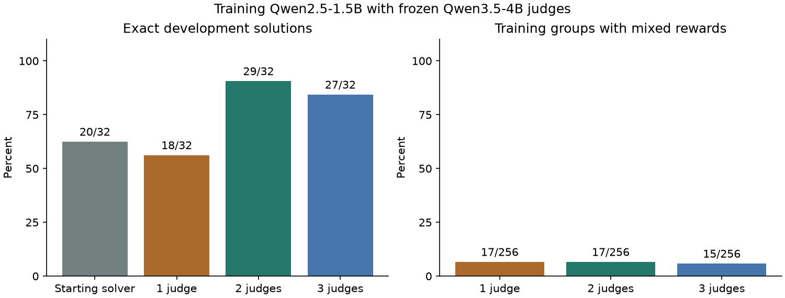

# Experiment index

## Solvers trained with frozen Qwen3.5-4B judges

| Solver reward | Updates | Groups with mixed rewards | Exact development solutions |
| --- | --- | --- | --- |
| Starting solver | 0 | — | 20/32 (62.5%) |
| Frozen Qwen3.5-4B Judge 1 | 256 | 17/256 | 18/32 (56.2%) |
| Frozen Qwen3.5-4B Judge 2 | 256 | 17/256 | 29/32 (90.6%) |
| Frozen Qwen3.5-4B Judge 3 | 256 | 15/256 | 27/32 (84.4%) |

Relative to the one-judge solver, the two-judge solver gained 12 solutions and lost 1. The three-judge solver gained 10 and lost 1. Three minus two was -6.25 percentage points. The one-judge baseline was registered after the deeper scores were known. On the two-judge run’s own training answers, Judge 2 changed relative credit in 1/256 groups compared with Judge 1. On the three-judge run’s own answers, Judge 3 fixed 4 verdicts and introduced 0 errors, changing relative credit in 0/256 groups. The one- and two-judge runs first sampled different answers at update 8. Their actual relative credit first differed at update 22. The logs leave the cause of the initial divergence unresolved. The paired intervals describe these seed-17 checkpoints on the development cohort. [Protocol and decoder](https://github.com/BurnyCoder/verifying-verifier-of-verifier-llm-reinforcement-learning/blob/main/reports/newer-frozen-judges.md#online-solver-comparison) · [Rollouts, rewards and exact scores](https://github.com/BurnyCoder/verifying-verifier-of-verifier-llm-reinforcement-learning/tree/main/results/new-judges).

The single-judge arm uses Judge 1's first verdict directly. Each additional judge reads the earlier reports. Only the solver learns. All runs use matched initialization, seed, prompt order and update budget. [One-judge addendum](https://github.com/BurnyCoder/verifying-verifier-of-verifier-llm-reinforcement-learning/blob/main/reports/newer-frozen-judges.md#one-judge-baseline-addendum).

| Solver comparison | Gained | Lost | Difference (pp) | Paired 95% interval (pp) |
| --- | --- | --- | --- | --- |
| One minus starting solver | 3 | 5 | -6.25 | -25.0 to +9.4 |
| Two minus one | 12 | 1 | +34.38 | +15.6 to +53.1 |
| Three minus one | 10 | 1 | +28.12 | +9.4 to +46.9 |
| Three minus two | 0 | 2 | -6.25 | -15.6 to +0.0 |

Gains and losses compare the same problem across checkpoints. Intervals resample problems within this one seed.

### Grading each checkpoint's fixed answers

| Whose written answers? | Exact solver answers | Correct J1 verdicts | Correct J2 verdicts | Correct J3 verdicts | J3 fixes | J3 new errors |
| --- | --- | --- | --- | --- | --- | --- |
| Solver trained with Judge 1 | 18/32 | 20/32 | 20/32 | 20/32 | 0 | 0 |
| Solver trained with Judge 2 | 29/32 | 28/32 | 28/32 | 28/32 | 0 | 0 |
| Solver trained with Judge 3 | 27/32 | 26/32 | 26/32 | 26/32 | 0 | 0 |

A correct verdict accepts correct arithmetic or rejects an arithmetic or format error. Changing a verdict in this replay leaves the solver’s written answer fixed. All three graders returned the same solution verdict on 96/96 saved development answers across the three checkpoints.

### What each solver wrote on the same calculation

| Expression | Exact steps | One-judge solver | Two-judge solver | Three-judge solver |
| --- | --- | --- | --- | --- |
| (7 - 7) + 12 | 0, 12 | `0,19` (wrong) | `0,19` (wrong) | `0,19` (wrong) |
| (39 + 12) - 5 | 51, 46 | `51,46` (correct) | `51,46` (correct) | `51,46` (correct) |
| (47 - 9) - 7 | 38, 31 | `38, 21` (wrong) | `38,31` (correct) | `38,31` (correct) |
| (12 - 12) + 11 | 0, 11 | `0,13` (wrong) | `0,11` (correct) | `0,13` (wrong) |
| (1 + 6) - 6 | 7, 1 | `7,1` (correct) | `7,-5` (wrong) | `7, -5` (wrong) |

Each row is the first development problem with that combination of successes and failures. The entries give the predicted first and second step. The explorer shows the literal judge reports for every answer in these rows. [Interactive explorer](https://burnycoder.github.io/verifying-verifier-of-verifier-llm-reinforcement-learning/)

### Solver precision and pretraining-only hardware checks

| Solver | Precision | GPU test | Parsed | Exact | Peak solver allocation |
| --- | --- | --- | --- | --- | --- |
| Qwen2.5-1.5B-Instruct | NF4 | One update completed | 16/16 | 10/16 | 1,990 MiB |
| Qwen2.5-1.5B-Instruct | BF16 | One update completed | 16/16 | 9/16 | 3,161 MiB |
| Qwen3.5-2B-Base | NF4 | One update completed | 16/16 | 12/16 | 3,587 MiB |

Starting accuracy uses greedy decoding on the same train-split calibration problems before the disposable update. The 4B judge ran on the same GPU. Peak allocation is PyTorch memory for the solver process alone. Against the original NF4 solver, Qwen2.5-1.5B-Instruct at BF16 gained 0 and lost 1 exact answers on the same 16 starting prompts. The descriptive paired difference was -6.2 percentage points (95% resampling interval -18.8 to +0.0). Against the original NF4 solver, Qwen3.5-2B-Base at NF4 gained 4 and lost 2 exact answers on the same 16 starting prompts. The descriptive paired difference was +12.5 percentage points (95% resampling interval -18.8 to +43.8). The pretraining-only base model received rewards [1, 0, 1, 1] and an optimizer gradient norm of 6.062. It is the candidate for a future matched comparison starting before RLVR. The longer-term effect on solver accuracy remains open. [Hardware protocol](https://github.com/BurnyCoder/verifying-verifier-of-verifier-llm-reinforcement-learning/blob/main/reports/solver-precision.md) · [Measured costs and outcomes](https://github.com/BurnyCoder/verifying-verifier-of-verifier-llm-reinforcement-learning/tree/main/results/solver-fit).

[Precision trials, paired arithmetic scores and the actual optimizer groups](https://github.com/BurnyCoder/verifying-verifier-of-verifier-llm-reinforcement-learning/blob/main/reports/reviews/solver-precision.md).

[Paired effects and independent reward checks](https://github.com/BurnyCoder/verifying-verifier-of-verifier-llm-reinforcement-learning/blob/main/reports/reviews/online-solvers.md).

[Run inventory, including upcoming experiments](https://github.com/BurnyCoder/verifying-verifier-of-verifier-llm-reinforcement-learning/blob/main/reports/run-inventory.md) · [Newer frozen Qwen protocol](https://github.com/BurnyCoder/verifying-verifier-of-verifier-llm-reinforcement-learning/blob/main/reports/newer-frozen-judges.md) · [Paused solver checkpoint, update 16](https://huggingface.co/BurnyCoder/recursive-judge-grpo-adapters/tree/5274be501a83e4c881664370cfe75f912c69413f/resumable/calibrated/top-depth2/checkpoint-16)

The original and calibrated training comparisons use grouped reinforcement learning with one active LoRA adapter on Qwen2.5-1.5B-Instruct. The solver predicts values in signed-integer expression trees. Judges predict evidence records about earlier outputs. A parsed output supplies the required number of integers. An exact output also gets every field right. The hardware trials state the backbone and storage precision for each disposable update.

| Run | Role | Reward | Seed | Problem source | Dev. parsed | Dev. exact | Held-out exact |
| --- | --- | --- | --- | --- | --- | --- | --- |
| base | solver | untrained | 17 | arithmetic | 100.0% | 62.5% | — |
| d3-17 | solver | d3 | 17 | arithmetic | 96.9% | 9.4% | — |
| d2-17 | solver | d2 | 17 | arithmetic | 100.0% | 78.1% | — |
| d1-17 | solver | d1 | 17 | arithmetic | 100.0% | 65.6% | — |
| flat-17 | solver | flat | 17 | arithmetic | 87.5% | 75.0% | — |
| oracle-17 | solver | oracle | 17 | arithmetic | 100.0% | 100.0% | — |
| hybrid-17 | solver | hybrid | 17 | arithmetic | 100.0% | 96.9% | — |
| shuffle-17 | solver | shuffle | 17 | arithmetic | 100.0% | 15.6% | — |
| exact-j1 | j1 | exact | 17 | base | 100.0% | 62.5% | — |
| exact-j2 | j2 | exact | 17 | base | 100.0% | 46.9% | — |
| exact-j3 | j3 | exact | 17 | base | 96.9% | 31.2% | — |
| top-j2 | j2 | teacher | 17 | base | 100.0% | 43.8% | — |
| top-j1 | j1 | teacher | 17 | base | 100.0% | 50.0% | — |
| exact-prefix1 | solver | d3 | 17 | arithmetic | 100.0% | 75.0% | — |
| exact-prefix2 | solver | d3 | 17 | arithmetic | 100.0% | 12.5% | — |
| exact-prefix3 | solver | d3 | 17 | arithmetic | 100.0% | 78.1% | — |
| top-prefix1 | solver | d3 | 17 | arithmetic | 21.9% | 6.2% | — |
| top-prefix2 | solver | d3 | 17 | arithmetic | 100.0% | 96.9% | — |
| top-prefix3 | solver | d3 | 17 | arithmetic | 100.0% | 87.5% | — |
| alt-exact-j1 | j1 | exact | 17 | exact-prefix3 | 100.0% | 62.5% | — |
| alt-exact-j2 | j2 | exact | 17 | exact-prefix3 | 100.0% | 46.9% | — |
| alt-exact-j3 | j3 | exact | 17 | exact-prefix3 | 100.0% | 31.2% | — |
| alt-exact-solver | solver | d3 | 17 | arithmetic | 100.0% | 6.2% | — |
| alt-top-j3 | j3 | exact | 17 | top-prefix3 | 100.0% | 31.2% | — |
| exact-depth1 | solver | d1 | 17 | arithmetic | 100.0% | 62.5% | — |
| exact-depth2 | solver | d2 | 17 | arithmetic | 100.0% | 62.5% | — |
| top-depth1 | solver | d1 | 17 | arithmetic | 100.0% | 78.1% | — |
| top-depth2 | solver | d2 | 17 | arithmetic | — | — | — |
| learn-oracle-17 | solver | oracle | 17 | arithmetic | — | — | — |
| learn-shuffle-17 | solver | oracle-shuffle | 17 | arithmetic | — | — | — |

[Update counts and sample sizes](../summary.md) · [Objectives and curricula](../planned-runs.md) · [Analysis protocol](../preregistration.md)

- [base](calibrated/base/experiment.md)
- [d3-17](calibrated/d3-17/experiment.md)
- [d2-17](calibrated/d2-17/experiment.md)
- [d1-17](calibrated/d1-17/experiment.md)
- [flat-17](calibrated/flat-17/experiment.md)
- [oracle-17](calibrated/oracle-17/experiment.md)
- [hybrid-17](calibrated/hybrid-17/experiment.md)
- [shuffle-17](calibrated/shuffle-17/experiment.md)
- [exact-j1](calibrated/exact-j1/experiment.md)
- [exact-j2](calibrated/exact-j2/experiment.md)
- [exact-j3](calibrated/exact-j3/experiment.md)
- [top-j2](calibrated/top-j2/experiment.md)
- [top-j1](calibrated/top-j1/experiment.md)
- [exact-prefix1](calibrated/exact-prefix1/experiment.md)
- [exact-prefix2](calibrated/exact-prefix2/experiment.md)
- [exact-prefix3](calibrated/exact-prefix3/experiment.md)
- [top-prefix1](calibrated/top-prefix1/experiment.md)
- [top-prefix2](calibrated/top-prefix2/experiment.md)
- [top-prefix3](calibrated/top-prefix3/experiment.md)
- [alt-exact-j1](calibrated/alt-exact-j1/experiment.md)
- [alt-exact-j2](calibrated/alt-exact-j2/experiment.md)
- [alt-exact-j3](calibrated/alt-exact-j3/experiment.md)
- [alt-exact-solver](calibrated/alt-exact-solver/experiment.md)
- [alt-top-j3](calibrated/alt-top-j3/experiment.md)
- [exact-depth1](calibrated/exact-depth1/experiment.md)
- [exact-depth2](calibrated/exact-depth2/experiment.md)
- [top-depth1](calibrated/top-depth1/experiment.md)
- [top-depth2](calibrated/top-depth2/experiment.md)
- [learn-oracle-17](learn-oracle-17/experiment.md)
- [learn-shuffle-17](learn-shuffle-17/experiment.md)
- [Original base](base/experiment.md)
- [Original d3-17](d3-17/experiment.md)
- [Hardware trial with Qwen/Qwen2.5-1.5B-Instruct at NF4](solver-fit/original-nf4/experiment.md)
- [Hardware trial with Qwen/Qwen2.5-1.5B-Instruct at BF16](solver-fit/original-bf16/experiment.md)
- [Hardware trial with Qwen/Qwen3.5-2B-Base at NF4](solver-fit/base-2b/experiment.md)
