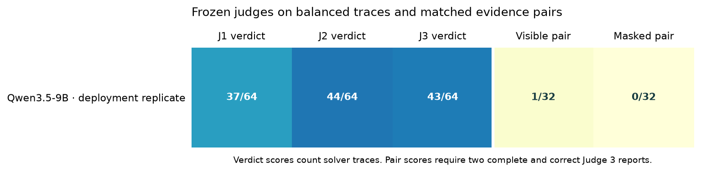

## Newer frozen judges on fixed solver answers

Every depth grades the same solver responses within a cohort. A visible-pair success requires both complete audit records and the exact numerical correction. Each balanced problem contributes one valid trace and one invalid trace.

| Model and cohort | J1 verdict | J2 verdict | J3 verdict | J3 visible pairs | J3 masked pairs |
| --- | --- | --- | --- | --- | --- |
| Qwen3.5-9B · deployment replicate · balanced | 37/64 | 44/64 | 43/64 | 1/32 | 0/32 |
| Qwen3.5-9B · deployment replicate · natural | 23/32 | 24/32 | 24/32 | — | — |

Qwen3.5-9B · Archived, invalid scoring. Empty reasoning wrapper on 65/65 delivered messages. No accuracy estimate..

Qwen3.5-9B (deployment replicate, Ollama-Qwen3.5-9B-Q4_K_M.gguf) used 191,377 input and 4,963 output tokens in 241.4 seconds of end-to-end calls. On the 32 natural traces, Judge 3 fixed 0 verdicts and introduced 0 errors.

[Protocol and case selection](../../newer-frozen-judges.md).
