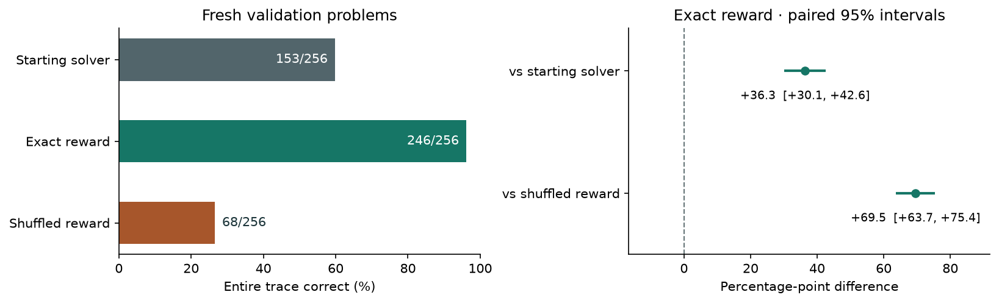

# Can this model learn the benchmark?

The frozen-model screen and the checkpoint comparison answer different questions. The screen measures attainable difficulty. The training probe measures change on a fresh validation sample. [Registered selection and decision rules](learnability-preregistration.md).

## Frozen-model screen

| Family | Prompt | Problems | Parsed samples | Sample exact | Greedy exact | Mixed groups |
| --- | --- | --- | --- | --- | --- | --- |
| one | registered | 16 | 1.6% | 0.0% | 0.0% | 0 |
| one | demonstrated | 16 | 81.2% | 81.2% | 93.8% | 4 |
| two-add | registered | 16 | 0.0% | 0.0% | 0.0% | 0 |
| two-add | demonstrated | 16 | 100.0% | 53.1% | 56.2% | 2 |
| two-mixed | registered | 16 | 0.0% | 0.0% | 0.0% | 0 |
| two-mixed | demonstrated | 16 | 100.0% | 56.2% | 75.0% | 5 |
| registered | registered | 16 | 35.9% | 0.0% | 0.0% | 0 |
| registered | demonstrated | 16 | 98.4% | 12.5% | 12.5% | 3 |

The registered rule selected two-add with demonstrated prompts.

Independent confirmation passed. On 48 problems, 99.0% of sampled outputs parsed, 54.2% were exact, and 16 groups contained both correct and incorrect answers.

## Frozen judges on balanced correct and incorrect traces

| Judge | Valid | Invalid | Sensitivity | Specificity | Balanced accuracy | Whole record exact | Malformed |
| --- | --- | --- | --- | --- | --- | --- | --- |
| 1 | 16 | 16 | 81.2% | 12.5% | 46.9% | 40.6% | 0 |
| 2 | 16 | 16 | 68.8% | 12.5% | 40.6% | 34.4% | 0 |
| 3 | 16 | 16 | 62.5% | 18.8% | 40.6% | 31.2% | 2 |

Judge 3 solved 0.0% of 16 complete evidence pairs with the review visible and 0.0% with evidence masked.

## Fresh learning-validation problems

| Checkpoint | Problems | Parsed | Entire trace correct | Exact accuracy |
| --- | --- | --- | --- | --- |
| base | 256 | 256 | 153 | 59.8% |
| learn-oracle-17 | 256 | 255 | 246 | 96.1% |
| learn-shuffle-17 | 256 | 256 | 68 | 26.6% |

The registered learning criterion was met.

The paired comparison also supports a reward-specific improvement.

| Exact-trained minus | Gain (pp) | 95% lower (pp) | 95% upper (pp) | Fixed | Harmed |
| --- | --- | --- | --- | --- | --- |
| Frozen base | +36.33 | +30.08 | +42.58 | 96 | 3 |
| Shuffled control | +69.53 | +63.67 | +75.39 | 179 | 1 |

### Formatting and arithmetic changes against base

| Parse status | Problems | Gained complete correctness | Lost complete correctness |
| --- | --- | --- | --- |
| Both parsed | 255 | 96 | 3 |
| Only trained parsed | 0 | 0 | 0 |
| Only comparator parsed | 1 | 0 | 0 |
| Neither parsed | 0 | 0 | 0 |

Both parsed · gain

<pre>Problem   (13 + 1) - 4
Expected  14,10
Comparator
9,5
Exact-trained
14,10</pre>

Both parsed · loss

<pre>Problem   (25 - 11) + 6
Expected  14,20
Comparator
14,20
Exact-trained
14,19</pre>

### Formatting and arithmetic changes against shuffled

| Parse status | Problems | Gained complete correctness | Lost complete correctness |
| --- | --- | --- | --- |
| Both parsed | 255 | 179 | 1 |
| Only trained parsed | 0 | 0 | 0 |
| Only comparator parsed | 1 | 0 | 0 |
| Neither parsed | 0 | 0 | 0 |

Both parsed · gain

<pre>Problem   (24 - 9) + 5
Expected  15,20
Comparator
19,24
Exact-trained
15,20</pre>

Both parsed · loss

<pre>Problem   (25 - 11) + 6
Expected  14,20
Comparator
14,20
Exact-trained
14,19</pre>
