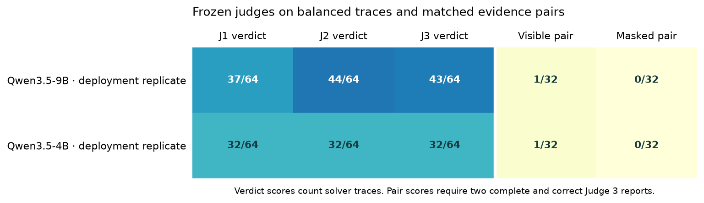

# Progress · 2026-11-27

23 of 32 registered training blocks have completed. 0 have completed final evaluation. Amended primary comparison is pending. Every arm uses two-add problems and demonstrated prompts.

[Run inventory, including upcoming experiments](https://github.com/BurnyCoder/verifying-verifier-of-verifier-llm-reinforcement-learning/blob/main/reports/run-inventory.md) · [Newer frozen Qwen protocol](https://github.com/BurnyCoder/verifying-verifier-of-verifier-llm-reinforcement-learning/blob/main/reports/newer-frozen-judges.md)

Owner prioritized GPU-only frozen newer Qwen judging and deferred optimization and sealed evaluation to a later day. Any conditional solver training with a newer judge is also deferred.

calibrated/top-depth2 · Paused · 20/256 logged, checkpoint 16.

## Newer frozen judges on fixed solver answers

Every depth grades the same solver responses within a cohort. A visible-pair success requires both complete audit records and the exact numerical correction. Each balanced problem contributes one valid trace and one invalid trace.

| Model and cohort | J1 verdict | J2 verdict | J3 verdict | J3 visible pairs | J3 masked pairs |
| --- | --- | --- | --- | --- | --- |
| Qwen3.5-9B · deployment replicate · balanced | 37/64 | 44/64 | 43/64 | 1/32 | 0/32 |
| Qwen3.5-9B · deployment replicate · natural | 23/32 | 24/32 | 24/32 | — | — |
| Qwen3.5-4B · deployment replicate · balanced | 32/64 | 32/64 | 32/64 | 1/32 | 0/32 |
| Qwen3.5-4B · deployment replicate · natural | 26/32 | 26/32 | 26/32 | — | — |
| Qwen2.5-1.5B-Instruct · screen · balanced | 32/64 | 28/64 | 28/64 | 0/32 | 0/32 |
| Qwen2.5-1.5B-Instruct · screen · natural | 23/32 | 19/32 | 13/32 | — | — |
| Qwen3.5-4B · screen · balanced | 35/64 | 35/64 | 35/64 | 7/32 | 0/32 |
| Qwen3.5-4B · screen · natural | 24/32 | 24/32 | 24/32 | — | — |

Qwen3.5-9B · Archived, invalid scoring. Empty reasoning wrapper on 65/65 delivered messages. No accuracy estimate..

Qwen3.5-9B (deployment replicate, Ollama-Qwen3.5-9B-Q4_K_M.gguf) used 191,377 input and 4,963 output tokens in 241.4 seconds of end-to-end calls. On the 32 natural traces, Judge 3 fixed 0 verdicts and introduced 0 errors.

Qwen3.5-4B (deployment replicate, Ollama-Qwen3.5-4B-Q4_K_M.gguf) used 191,363 input and 4,918 output tokens in 158.2 seconds of end-to-end calls. On the 32 natural traces, Judge 3 fixed 0 verdicts and introduced 0 errors.

Qwen2.5-1.5B-Instruct (screen, qwen2.5-1.5b-instruct-q4_k_m.gguf) used 189,653 input and 5,036 output tokens in 61.3 seconds of end-to-end calls. On the 32 natural traces, Judge 3 fixed 4 verdicts and introduced 10 errors.

Qwen3.5-4B (screen, Qwen3.5-4B-Q4_K_M.gguf) used 191,362 input and 4,918 output tokens in 162.2 seconds of end-to-end calls. On the 32 natural traces, Judge 3 fixed 0 verdicts and introduced 0 errors.

The comparison of two conversions of the same model was exploratory. Both used the same llama.cpp CUDA executable. The experiment varies each complete model file, so a specific conversion difference cannot be identified as the cause.

Qwen3.5-4B passed 7/32 whole pairs with the Unsloth release and 1/32 with the Ollama release. Of 64 matched visible reviews, 64 had identical messages, 64 had identical rendered prompts, 64 had equal input token counts and 27 produced identical output text.

The matched-depth extension has trained 3 of 4 additional shallow solvers. [Extension](matched-depth-protocol.md).

The timing pilot selected 256 updates per block at 38.3 seconds per pilot update. A block at that rate would take 2.72 hours.

The first single-seed solver has a 14-hour target. The matrix has a one-week training target. Monitoring cadence and milestone order are in the [plan](plan.md). The [experiment index](experiments/experiments.md) contains available development observations.
