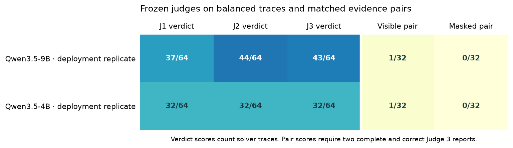

# Study summary

[Run inventory, including upcoming experiments](https://github.com/BurnyCoder/verifying-verifier-of-verifier-llm-reinforcement-learning/blob/main/reports/run-inventory.md) · [Newer frozen Qwen protocol](https://github.com/BurnyCoder/verifying-verifier-of-verifier-llm-reinforcement-learning/blob/main/reports/newer-frozen-judges.md) · [Paused solver checkpoint, update 16](https://huggingface.co/BurnyCoder/recursive-judge-grpo-adapters/tree/5274be501a83e4c881664370cfe75f912c69413f/resumable/calibrated/top-depth2/checkpoint-16)

## Matched accuracy by judge depth

Each column adds one review of the preceding judge. Judge 1 checks the solver, Judge 2 checks Judge 1, and Judge 3 checks Judge 2. Across a solver-training row only the depth of its reward changes. All solver comparisons here use seed 17.

### Development solver accuracy

Every solver answers the same 32 questions. A solution is correct when every intermediate value is correct. Fitted judges stay frozen during solver updates.

| Training condition | One judge · J1 | Two judges · J2 checks J1 | Three judges · J3 checks J2 |
| --- | --- | --- | --- |
| Only solver trained · original judges | 21/32 (65.6%) | 25/32 (78.1%) | 3/32 (9.4%) |
| Exact-trained judges, then solver | 20/32 (62.5%) | 20/32 (62.5%) | 25/32 (78.1%) |
| Top-down-trained judges, then solver | 25/32 (78.1%) | Pending | 28/32 (87.5%) |

With judges first trained on exact labels, the one-judge and two-judge solver runs wrote identical text on 1,024/1,024 training completions. Their applied rewards matched on 1,024/1,024, with 1,024 and 1,024 positive rewards respectively. Their solver outputs also matched on 32/32 development questions.

### Development judge verdict accuracy

Every judge grades the same 32 saved responses from the starting solver. A verdict is correct when it agrees with the arithmetic checker. In all judge-only conditions the solver itself stays at 20/32 (62.5%) on the 32 solver-evaluation questions.

| Training condition | One judge · J1 | Two judges · J2 checks J1 | Three judges · J3 checks J2 |
| --- | --- | --- | --- |
| Original frozen judges | 19/32 (59.4%) | 19/32 (59.4%) | 17/32 (53.1%) |
| Exact labels · only final judge trained | 20/32 (62.5%) | 19/32 (59.4%) | 18/32 (56.2%) |
| Exact labels · all participating judges trained | 20/32 (62.5%) | 20/32 (62.5%) | 20/32 (62.5%) |
| Top-down supervision · only final judge trained | 20/32 (62.5%) | 19/32 (59.4%) | 18/32 (56.2%) |
| Top-down supervision · all participating judges trained | 20/32 (62.5%) | 18/32 (56.2%) | 18/32 (56.2%) |

On the original frozen judges’ row, Judge 3 fixed Judge 2’s verdict on 0/32 answers and introduced a grading error on 2/32. Always accepting scores 20/32 (62.5%) on these same responses. The stack trained on exact labels approved all 32 answers at every depth, including all 12 incorrect solutions. The stack trained top-down approved 32, 30, 30 answers at depths one, two and three, respectively. It accepted all 12 incorrect solutions at every depth.

Every verdict Judge 3 changed on the starting solver’s saved answers

| Problem | Starting solver wrote | Correct steps | Judge 2 | Judge 3 | Effect |
| --- | --- | --- | --- | --- | --- |
| <code>(46 + 3) - 10</code> | <code>56,46</code> | <code>49,39</code> | Endorses Judge 1 and supports the value 46. Rejects the solver and says step 1 should be 46. <code>1,0,46,0,1,46</code> | Flags field 3 of Judge 2 and proposes 46. Accepts the solver and gives 46 as its final value. <code>0,3,46,1,0,46</code> | Introduced a grading error |
| <code>(1 + 6) - 6</code> | <code>-5,-1</code> | <code>7,1</code> | Invalid review flag -1. Its solver fields say “Accepts the solver and gives -5 as its final value.” The effective verdict is reject. <code>-1,-1,-5,1,0,-5</code> | Endorses Judge 2 and supports the value -5. Accepts the solver and gives -5 as its final value. <code>1,0,-5,1,0,-5</code> | Introduced a grading error |

“Only final judge trained” fits the judge used for that column’s terminal decision and uses original judges for preceding calls. “All participating judges trained” uses fitted adapters at every depth. Top-down training uses the shared exact-trained Judge 3. Pending cells have no completed matched measurement. [Matched comparison protocol](matched-depth-protocol.md)

Amended primary comparison is pending. Every arm uses two-add problems and demonstrated prompts.

| Run | Updated role | Updates | Development exact | Development n | Held-out exact | Held-out n |
|---|---|---:|---:|---:|---:|---:|
| base | solver | — | 62.5% | 32 | — | 0 |
| d3-17 | solver | 256 | 9.4% | 32 | — | 0 |
| d2-17 | solver | 256 | 78.1% | 32 | — | 0 |
| d1-17 | solver | 256 | 65.6% | 32 | — | 0 |
| flat-17 | solver | 256 | 75.0% | 32 | — | 0 |
| oracle-17 | solver | 256 | 100.0% | 32 | — | 0 |
| hybrid-17 | solver | 256 | 96.9% | 32 | — | 0 |
| shuffle-17 | solver | 256 | 15.6% | 32 | — | 0 |
| exact-j1 | j1 | 256 | 62.5% | 32 | — | 0 |
| exact-j2 | j2 | 256 | 46.9% | 32 | — | 0 |
| exact-j3 | j3 | 256 | 31.2% | 32 | — | 0 |
| top-j2 | j2 | 256 | 43.8% | 32 | — | 0 |
| top-j1 | j1 | 256 | 50.0% | 32 | — | 0 |
| exact-prefix1 | solver | 256 | 75.0% | 32 | — | 0 |
| exact-prefix2 | solver | 256 | 12.5% | 32 | — | 0 |
| exact-prefix3 | solver | 256 | 78.1% | 32 | — | 0 |
| top-prefix1 | solver | 256 | 6.2% | 32 | — | 0 |
| top-prefix2 | solver | 256 | 96.9% | 32 | — | 0 |
| top-prefix3 | solver | 256 | 87.5% | 32 | — | 0 |
| alt-exact-j1 | j1 | 256 | 62.5% | 32 | — | 0 |
| alt-exact-j2 | j2 | 256 | 46.9% | 32 | — | 0 |
| alt-exact-j3 | j3 | 256 | 31.2% | 32 | — | 0 |
| alt-exact-solver | solver | 256 | 6.2% | 32 | — | 0 |
| alt-top-j3 | j3 | 256 | 31.2% | 32 | — | 0 |
| exact-depth1 | solver | 256 | 62.5% | 32 | — | 0 |
| exact-depth2 | solver | 256 | 62.5% | 32 | — | 0 |
| top-depth1 | solver | 256 | 78.1% | 32 | — | 0 |
| top-depth2 | solver | — | — | 0 | — | 0 |
| learn-oracle-17 | solver | 128 | — | 0 | — | 0 |
| learn-shuffle-17 | solver | 128 | — | 0 | — | 0 |

[How the third judge changed actual training rewards and worked examples](https://github.com/BurnyCoder/verifying-verifier-of-verifier-llm-reinforcement-learning/blob/main/reports/reviews/depth-diagnosis.md). [Side-by-side solver outputs and judge reports](https://github.com/BurnyCoder/verifying-verifier-of-verifier-llm-reinforcement-learning/blob/main/reports/reviews/paired-outputs-seed-17.md).

**Benchmark difficulty.** The frozen-model screen selected two-add with demonstrated prompts. On 16 screening problems it produced a mix of correct and incorrect answers on 2 problems. [All difficulty levels](learnability.md).

**Solver learning.** Exact-reward training changed complete-trace accuracy on 256 fresh problems by +36.3 percentage points relative to the starting solver (paired 95% interval +30.1 to +42.6). [Shuffled control and arithmetic corrections](learnability.md).

On the original signed development population, base solved 0/32, d3-17 solved 0/32.

**Untrained solver.** Every step was correct on 20 of 32 development problems. Of 0 malformed outputs, 0 contained all correct numbers as named assignments. Judge 3 corrected 0 of Judge 2’s verdicts and introduced 2 errors on these traces.

**First three-judge-trained solver.** Every step was correct on 3 of 32 development problems. Of 1 malformed outputs, 0 contained all correct numbers as named assignments. Judge 3 corrected 1 of Judge 2’s verdicts and introduced 1 errors on these traces.

### Reward and arithmetic during training, seed 17

In the last quarter Judge 3 rewarded **2/15 correct attempts** and **169/241 wrong attempts**. On these identical late answers, Judge 2 would have rewarded 4/15 correct attempts and 176/241 wrong ones. Both grades depend on which answers the evolving solver produces. These trajectories establish when the gap appeared. The contributions of individual updates and seed variation remain distinct questions. [All four quarters, denominators and original records](https://github.com/BurnyCoder/verifying-verifier-of-verifier-llm-reinforcement-learning/blob/main/reports/reviews/depth-diagnosis.md).

Solver scores require every intermediate value. Judge scores require all fields of the evidence record. Intervals condition on the trained checkpoints. [Preregistration](preregistration.md).

## Newer frozen judges on fixed solver answers

Every depth grades the same solver responses within a cohort. A visible-pair success requires both complete audit records and the exact numerical correction. Each balanced problem contributes one valid trace and one invalid trace. The last column counts Judge 2 errors that Judge 3 fixed, followed by correct Judge 2 verdicts that Judge 3 overturned.

| Model and cohort | J1 verdict | J2 verdict | J3 verdict | J3 visible pairs | J3 masked pairs | J3 fixes / new errors |
| --- | --- | --- | --- | --- | --- | --- |
| Qwen3.5-9B · deployment replicate · balanced | 37/64 | 44/64 | 43/64 | 1/32 | 0/32 | 0 / 1 |
| Qwen3.5-9B · deployment replicate · natural | 23/32 | 24/32 | 24/32 | — | — | 0 / 0 |
| Qwen3.5-4B · deployment replicate · balanced | 32/64 | 32/64 | 32/64 | 1/32 | 0/32 | 0 / 0 |
| Qwen3.5-4B · deployment replicate · natural | 26/32 | 26/32 | 26/32 | — | — | 0 / 0 |
| Qwen2.5-1.5B-Instruct · screen · balanced | 32/64 | 28/64 | 28/64 | 0/32 | 0/32 | 16 / 16 |
| Qwen2.5-1.5B-Instruct · screen · natural | 23/32 | 19/32 | 13/32 | — | — | 4 / 10 |
| Qwen3.5-4B · screen · balanced | 35/64 | 35/64 | 35/64 | 7/32 | 0/32 | 0 / 0 |
| Qwen3.5-4B · screen · natural | 24/32 | 24/32 | 24/32 | — | — | 0 / 0 |

Qwen3.5-9B · Archived, invalid scoring. Empty reasoning wrapper on 65/65 delivered messages. No accuracy estimate..

Qwen3.5-9B (deployment replicate, Ollama-Qwen3.5-9B-Q4_K_M.gguf) used 191,377 input and 4,963 output tokens in 241.4 seconds of end-to-end calls.

Qwen3.5-4B (deployment replicate, Ollama-Qwen3.5-4B-Q4_K_M.gguf) used 191,363 input and 4,918 output tokens in 158.2 seconds of end-to-end calls.

Qwen2.5-1.5B-Instruct (screen, qwen2.5-1.5b-instruct-q4_k_m.gguf) used 189,653 input and 5,036 output tokens in 61.3 seconds of end-to-end calls.

Qwen3.5-4B (screen, Qwen3.5-4B-Q4_K_M.gguf) used 191,362 input and 4,918 output tokens in 162.2 seconds of end-to-end calls.

The comparison of two conversions of the same model was exploratory. Both used the same llama.cpp CUDA executable. The experiment varies each complete model file, so a specific conversion difference cannot be identified as the cause.

Qwen3.5-4B passed 7/32 whole pairs with the Unsloth release and 1/32 with the Ollama release. Of 64 matched visible reviews, 64 had identical messages, 64 had identical rendered prompts, 64 had equal input token counts and 27 produced identical output text.

## Run inventory

The original solver and judge adapters all use Qwen2.5-1.5B-Instruct. A solver score counts complete arithmetic traces. A trained judge score counts complete evidence records. Stack replays report verdict agreement at each depth on the same saved answers. Pending means the phase has no completed measurement. A dash marks an inapplicable endpoint. Timing and calibration are outside the primary comparison.

### Original signed arithmetic

| Run | Treatment or measurement | Status | Development or pilot result | Held-out result |
| --- | --- | --- | --- | --- |
| [original/base](https://github.com/BurnyCoder/verifying-verifier-of-verifier-llm-reinforcement-learning/tree/main/results/base) | Untrained solver | Archived | 0/32 (0.0%) | Deferred |
| [original/d3-17](https://github.com/BurnyCoder/verifying-verifier-of-verifier-llm-reinforcement-learning/tree/main/results/d3-17) | Fresh solver, frozen J3, seed 17 | Archived | 0/32 (0.0%) | Deferred |
| [original/timing](https://github.com/BurnyCoder/verifying-verifier-of-verifier-llm-reinforcement-learning/blob/main/results/timing/trained.json) | Disposable solver, frozen J3, wall-clock pilot | Complete | 4 updates in 153.2 s | — |
| original/registered-only | Other original signed treatments and sealed evaluation | Superseded in this campaign | See calibrated arms below | Deferred |

### Difficulty and learning controls

| Run | Treatment or measurement | Status | Development or pilot result | Held-out result |
| --- | --- | --- | --- | --- |
| [screen/one-registered](https://github.com/BurnyCoder/verifying-verifier-of-verifier-llm-reinforcement-learning/blob/main/results/learnability/screen.json) | Frozen solver, greedy trace | Complete | 0/16 (0.0%) | — |
| [screen/one-demonstrated](https://github.com/BurnyCoder/verifying-verifier-of-verifier-llm-reinforcement-learning/blob/main/results/learnability/screen.json) | Frozen solver, greedy trace | Complete | 15/16 (93.8%) | — |
| [screen/two-add-registered](https://github.com/BurnyCoder/verifying-verifier-of-verifier-llm-reinforcement-learning/blob/main/results/learnability/screen.json) | Frozen solver, greedy trace | Complete | 0/16 (0.0%) | — |
| [screen/two-add-demonstrated](https://github.com/BurnyCoder/verifying-verifier-of-verifier-llm-reinforcement-learning/blob/main/results/learnability/screen.json) | Frozen solver, greedy trace | Complete | 9/16 (56.2%) | — |
| [screen/two-mixed-registered](https://github.com/BurnyCoder/verifying-verifier-of-verifier-llm-reinforcement-learning/blob/main/results/learnability/screen.json) | Frozen solver, greedy trace | Complete | 0/16 (0.0%) | — |
| [screen/two-mixed-demonstrated](https://github.com/BurnyCoder/verifying-verifier-of-verifier-llm-reinforcement-learning/blob/main/results/learnability/screen.json) | Frozen solver, greedy trace | Complete | 12/16 (75.0%) | — |
| [screen/registered-registered](https://github.com/BurnyCoder/verifying-verifier-of-verifier-llm-reinforcement-learning/blob/main/results/learnability/screen.json) | Frozen solver, greedy trace | Complete | 0/16 (0.0%) | — |
| [screen/registered-demonstrated](https://github.com/BurnyCoder/verifying-verifier-of-verifier-llm-reinforcement-learning/blob/main/results/learnability/screen.json) | Frozen solver, greedy trace | Complete | 2/16 (12.5%) | — |
| [learnability/confirm](https://github.com/BurnyCoder/verifying-verifier-of-verifier-llm-reinforcement-learning/blob/main/results/learnability/confirm.json) | Fresh difficulty confirmation, greedy trace | Complete | 31/48 (64.6%) | — |
| [learnability/audit](https://github.com/BurnyCoder/verifying-verifier-of-verifier-llm-reinforcement-learning/blob/main/results/learnability/audit.json) | Frozen balanced verdicts at J1/J2/J3 and visible J3 twins | Complete | 46.9% / 40.6% / 40.6%, twins 0/16 | — |
| [validation/base](https://github.com/BurnyCoder/verifying-verifier-of-verifier-llm-reinforcement-learning/blob/main/results/learnability/evaluations/base.json) | Frozen solver, independent validation | Complete | 153/256 (59.8%) | — |
| [validation/learn-oracle-17](https://github.com/BurnyCoder/verifying-verifier-of-verifier-llm-reinforcement-learning/blob/main/results/learnability/evaluations/learn-oracle-17.json) | Solver, exact reward, independent validation | Complete | 246/256 (96.1%) | — |
| [validation/learn-shuffle-17](https://github.com/BurnyCoder/verifying-verifier-of-verifier-llm-reinforcement-learning/blob/main/results/learnability/evaluations/learn-shuffle-17.json) | Solver, shuffled exact reward, independent validation | Complete | 68/256 (26.6%) | — |

### Main solver and judge study

| Run | Treatment or measurement | Status | Development or pilot result | Held-out result |
| --- | --- | --- | --- | --- |
| [calibrated/base](https://github.com/BurnyCoder/verifying-verifier-of-verifier-llm-reinforcement-learning/tree/main/results/calibrated/base) | Frozen starting solver | Development complete | 20/32 (62.5%) | Deferred |
| [calibrated/d3-17](https://github.com/BurnyCoder/verifying-verifier-of-verifier-llm-reinforcement-learning/tree/main/results/calibrated/d3-17) | Fresh solver, D3, seed 17 | Development complete | 3/32 (9.4%) | Deferred |
| [calibrated/d2-17](https://github.com/BurnyCoder/verifying-verifier-of-verifier-llm-reinforcement-learning/tree/main/results/calibrated/d2-17) | Fresh solver, D2, seed 17 | Development complete | 25/32 (78.1%) | Deferred |
| [calibrated/d1-17](https://github.com/BurnyCoder/verifying-verifier-of-verifier-llm-reinforcement-learning/tree/main/results/calibrated/d1-17) | Fresh solver, D1, seed 17 | Development complete | 21/32 (65.6%) | Deferred |
| [calibrated/flat-17](https://github.com/BurnyCoder/verifying-verifier-of-verifier-llm-reinforcement-learning/tree/main/results/calibrated/flat-17) | Fresh solver, three independent votes, seed 17 | Development complete | 24/32 (75.0%) | Deferred |
| [calibrated/oracle-17](https://github.com/BurnyCoder/verifying-verifier-of-verifier-llm-reinforcement-learning/tree/main/results/calibrated/oracle-17) | Fresh solver, exact trace, seed 17 | Development complete | 32/32 (100.0%) | Deferred |
| [calibrated/hybrid-17](https://github.com/BurnyCoder/verifying-verifier-of-verifier-llm-reinforcement-learning/tree/main/results/calibrated/hybrid-17) | Fresh solver, J3 and checker, seed 17 | Development complete | 31/32 (96.9%) | Deferred |
| [calibrated/shuffle-17](https://github.com/BurnyCoder/verifying-verifier-of-verifier-llm-reinforcement-learning/tree/main/results/calibrated/shuffle-17) | Fresh solver, within-group shuffled J3, seed 17 | Development complete | 5/32 (15.6%) | Deferred |
| [calibrated/exact-j1](https://github.com/BurnyCoder/verifying-verifier-of-verifier-llm-reinforcement-learning/tree/main/results/calibrated/exact-j1) | J1 learns from exact full report | Development complete | 20/32 (62.5%) | Deferred |
| [calibrated/exact-j2](https://github.com/BurnyCoder/verifying-verifier-of-verifier-llm-reinforcement-learning/tree/main/results/calibrated/exact-j2) | J2 learns from exact full report | Development complete | 15/32 (46.9%) | Deferred |
| [calibrated/exact-j3](https://github.com/BurnyCoder/verifying-verifier-of-verifier-llm-reinforcement-learning/tree/main/results/calibrated/exact-j3) | J3 learns from exact full report | Development complete | 10/32 (31.2%) | Deferred |
| [calibrated/top-j2](https://github.com/BurnyCoder/verifying-verifier-of-verifier-llm-reinforcement-learning/tree/main/results/calibrated/top-j2) | J2 learns from exact-j3 | Development complete | 14/32 (43.8%) | Deferred |
| [calibrated/top-j1](https://github.com/BurnyCoder/verifying-verifier-of-verifier-llm-reinforcement-learning/tree/main/results/calibrated/top-j1) | J1 learns from top-j2 | Development complete | 16/32 (50.0%) | Deferred |
| [calibrated/exact-prefix1](https://github.com/BurnyCoder/verifying-verifier-of-verifier-llm-reinforcement-learning/tree/main/results/calibrated/exact-prefix1) | Fresh solver, D3, 1 exact-trained judge, seed 17 | Development complete | 24/32 (75.0%) | Deferred |
| [calibrated/exact-prefix2](https://github.com/BurnyCoder/verifying-verifier-of-verifier-llm-reinforcement-learning/tree/main/results/calibrated/exact-prefix2) | Fresh solver, D3, 2 exact-trained judges, seed 17 | Development complete | 4/32 (12.5%) | Deferred |
| [calibrated/exact-prefix3](https://github.com/BurnyCoder/verifying-verifier-of-verifier-llm-reinforcement-learning/tree/main/results/calibrated/exact-prefix3) | Fresh solver, D3, 3 exact-trained judges, seed 17 | Development complete | 25/32 (78.1%) | Deferred |
| [calibrated/top-prefix1](https://github.com/BurnyCoder/verifying-verifier-of-verifier-llm-reinforcement-learning/tree/main/results/calibrated/top-prefix1) | Fresh solver, D3, 1 top-down judge, seed 17 | Development complete | 2/32 (6.2%) | Deferred |
| [calibrated/top-prefix2](https://github.com/BurnyCoder/verifying-verifier-of-verifier-llm-reinforcement-learning/tree/main/results/calibrated/top-prefix2) | Fresh solver, D3, 2 top-down judges, seed 17 | Development complete | 31/32 (96.9%) | Deferred |
| [calibrated/top-prefix3](https://github.com/BurnyCoder/verifying-verifier-of-verifier-llm-reinforcement-learning/tree/main/results/calibrated/top-prefix3) | Fresh solver, D3, 3 top-down judges, seed 17 | Development complete | 28/32 (87.5%) | Deferred |
| [calibrated/alt-exact-j1](https://github.com/BurnyCoder/verifying-verifier-of-verifier-llm-reinforcement-learning/tree/main/results/calibrated/alt-exact-j1) | J1 learns from exact full report, continuing exact-j1 | Development complete | 20/32 (62.5%) | Deferred |
| [calibrated/alt-exact-j2](https://github.com/BurnyCoder/verifying-verifier-of-verifier-llm-reinforcement-learning/tree/main/results/calibrated/alt-exact-j2) | J2 learns from exact full report, continuing exact-j2 | Development complete | 15/32 (46.9%) | Deferred |
| [calibrated/alt-exact-j3](https://github.com/BurnyCoder/verifying-verifier-of-verifier-llm-reinforcement-learning/tree/main/results/calibrated/alt-exact-j3) | J3 learns from exact full report, continuing exact-j3 | Development complete | 10/32 (31.2%) | Deferred |
| [calibrated/alt-exact-solver](https://github.com/BurnyCoder/verifying-verifier-of-verifier-llm-reinforcement-learning/tree/main/results/calibrated/alt-exact-solver) | Continue solver, D3, 3 exact-trained judges, seed 17 | Development complete | 2/32 (6.2%) | Deferred |
| [calibrated/alt-top-j3](https://github.com/BurnyCoder/verifying-verifier-of-verifier-llm-reinforcement-learning/tree/main/results/calibrated/alt-top-j3) | J3 learns from exact full report, continuing exact-j3 | Development complete | 10/32 (31.2%) | Deferred |
| calibrated/alt-top-j2 | J2 learns from alt-top-j3, continuing top-j2 | Deferred | Pending | Deferred |
| calibrated/alt-top-j1 | J1 learns from alt-top-j2, continuing top-j1 | Deferred | Pending | Deferred |
| calibrated/alt-top-solver | Continue solver, D3, 3 top-down judges, seed 17 | Deferred | Pending | Deferred |
| calibrated/d3-29 | Fresh solver, D3, seed 29 | Deferred | Pending | Deferred |
| calibrated/d2-29 | Fresh solver, D2, seed 29 | Deferred | Pending | Deferred |
| calibrated/flat-29 | Fresh solver, three independent votes, seed 29 | Deferred | Pending | Deferred |
| calibrated/d3-43 | Fresh solver, D3, seed 43 | Deferred | Pending | Deferred |
| calibrated/d2-43 | Fresh solver, D2, seed 43 | Deferred | Pending | Deferred |
| calibrated/flat-43 | Fresh solver, three independent votes, seed 43 | Deferred | Pending | Deferred |

### Matched trained judge depths

| Run | Treatment or measurement | Status | Development or pilot result | Held-out result |
| --- | --- | --- | --- | --- |
| [calibrated/exact-depth1](https://github.com/BurnyCoder/verifying-verifier-of-verifier-llm-reinforcement-learning/tree/main/results/calibrated/exact-depth1) | Fresh solver, D1, 1 exact-trained judge, seed 17 | Development complete | 20/32 (62.5%) | Deferred |
| [calibrated/exact-depth2](https://github.com/BurnyCoder/verifying-verifier-of-verifier-llm-reinforcement-learning/tree/main/results/calibrated/exact-depth2) | Fresh solver, D2, 2 exact-trained judges, seed 17 | Development complete | 20/32 (62.5%) | Deferred |
| [calibrated/top-depth1](https://github.com/BurnyCoder/verifying-verifier-of-verifier-llm-reinforcement-learning/tree/main/results/calibrated/top-depth1) | Fresh solver, D1, 1 top-down judge, seed 17 | Development complete | 25/32 (78.1%) | Deferred |
| [calibrated/top-depth2](https://github.com/BurnyCoder/verifying-verifier-of-verifier-llm-reinforcement-learning/tree/main/results/calibrated/top-depth2) | Fresh solver, D2, 2 top-down judges, seed 17 | Paused · 20/256 logged, checkpoint 16 | Pending | Deferred |
| [replay/exact](https://github.com/BurnyCoder/verifying-verifier-of-verifier-llm-reinforcement-learning/tree/main/results/calibrated/matched-depth) | Frozen fitted stack, J1/J2/J3 on identical base traces | Development complete | 20/32 · 20/32 · 20/32 | Deferred |
| [replay/top](https://github.com/BurnyCoder/verifying-verifier-of-verifier-llm-reinforcement-learning/tree/main/results/calibrated/matched-depth) | Frozen fitted stack, J1/J2/J3 on identical base traces | Development complete | 20/32 · 18/32 · 18/32 | Deferred |

### Final evaluation and transfer

| Run | Treatment or measurement | Status | Development or pilot result | Held-out result |
| --- | --- | --- | --- | --- |
| analysis/primary | D3 minus D2, paired across seeds 17, 29 and 43 | Deferred | — | Pending |
| analysis/flat | D3 minus three independent votes, same seeds | Deferred | — | Pending |
| cohort/test | Primary arithmetic, 2,048 questions per solver | Deferred | — | Pending |
| cohort/layout | Reserved tree layouts, 128 questions per solver | Deferred | — | Pending |
| cohort/long | Longer expressions, 128 questions per solver | Deferred | — | Pending |
| cohort/original-difficulty | Signed arithmetic, 2,048 questions per solver | Deferred | — | Pending |
| cohort/mechanism | Familiar evidence and layout, 128 evidence pairs, visible and masked | Deferred | — | Pending |
| cohort/unseen-evidence | Unseen error pattern, 128 evidence pairs, visible and masked | Deferred | — | Pending |
| cohort/layout-evidence | Reserved layout, 128 evidence pairs, visible and masked | Deferred | — | Pending |
| cohort/transfer-evidence | Unseen error and reserved layout, 128 evidence pairs, visible and masked | Deferred | — | Pending |

### Newer frozen Qwen judges

| Run | Treatment or measurement | Status | Development or pilot result | Held-out result |
| --- | --- | --- | --- | --- |
| [new-judges/runtime-format-pilot](https://github.com/BurnyCoder/verifying-verifier-of-verifier-llm-reinforcement-learning/tree/main/results/new-judges/runtime-format-pilot) | Qwen3.5-9B server-output formatting diagnostic | Archived, invalid scoring | Empty reasoning wrapper on 65/65 delivered messages. No accuracy estimate. | — |
| [new-judges/q35-9b-ollama](https://github.com/BurnyCoder/verifying-verifier-of-verifier-llm-reinforcement-learning/tree/main/results/new-judges/q35-9b-ollama) | Qwen3.5-9B frozen, Ollama Q4_K_M deployment replicate | Complete | J3 verdict 43/64, twins 1/32, masked 0/32 | — |
| [new-judges/q35-4b-ollama](https://github.com/BurnyCoder/verifying-verifier-of-verifier-llm-reinforcement-learning/tree/main/results/new-judges/q35-4b-ollama) | Qwen3.5-4B frozen, Ollama Q4_K_M deployment replicate | Complete | J3 verdict 32/64, twins 1/32, masked 0/32 | — |
| [new-judges/q25-1p5b](https://github.com/BurnyCoder/verifying-verifier-of-verifier-llm-reinforcement-learning/tree/main/results/new-judges/q25-1p5b) | Qwen2.5-1.5B-Instruct frozen, same-runtime screen | Complete | J3 verdict 28/64, twins 0/32, masked 0/32 | — |
| [new-judges/q35-4b](https://github.com/BurnyCoder/verifying-verifier-of-verifier-llm-reinforcement-learning/tree/main/results/new-judges/q35-4b) | Qwen3.5-4B frozen, same-runtime screen | Complete | J3 verdict 35/64, twins 7/32, masked 0/32 | — |
| new-judges/q35-9b | Qwen3.5-9B frozen, same-runtime screen | Planned | Pending | — |
| new-judges/q38-27b | Qwen3.8-27B frozen, same-runtime screen | Planned | Pending | — |
| new-judges/confirm-control | Frozen Qwen2.5 control, fresh confirmation | Conditional | Pending | — |
| new-judges/confirm-winner | Selected newer frozen judge, fresh confirmation | Conditional | Pending | — |
| new-judges/winner-d2 | Fresh Qwen2.5 solver, selected frozen J2 reward, seed 17 | Conditional, later day | Pending | — |
| new-judges/winner-d3 | Fresh Qwen2.5 solver, selected frozen J3 reward, seed 17 | Conditional, later day | Pending | — |
